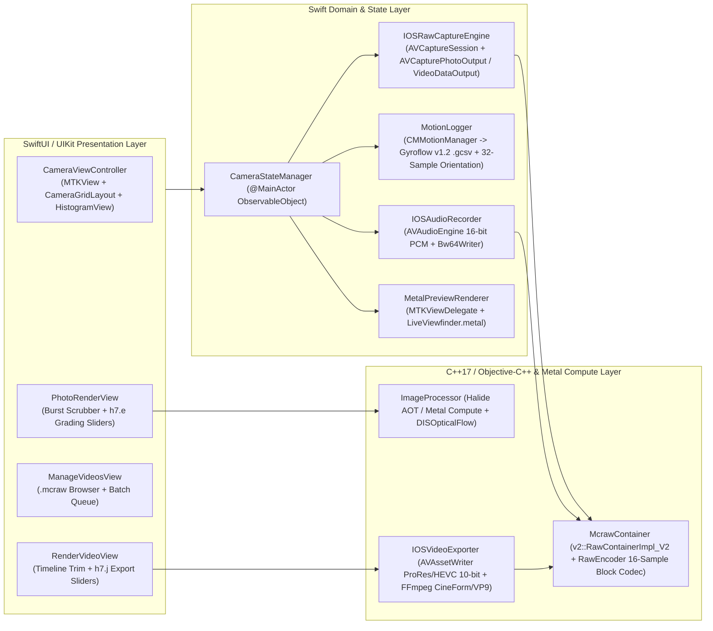

# MotionCam Pro 1.2.7 — Complete Reverse-Engineering Specification & iOS/Swift Porting Blueprint

**Source Artifact:** `Raw.apk` (`com.motioncam.pro`, `versionName="1.2.7-pro"`, `versionCode=318`, `compileSdk=32`, `minSdkVersion=25`, `targetSdkVersion=32`)  
**APK Size:** `25,724,822` bytes  
**APK SHA-256:** `55b76c30091bc9e6dda0a27bb3bf5de47ea36b726aba0c6cfc238e1f46b9b468`  
**Primary Native Engine:** `lib/arm64-v8a/libnative-camera-host.so` (`20,955,040` bytes, ELF64 `aarch64`, dynamically exporting 64 JNI functions and 1,159 `motioncam::*` C++ symbols)

---

## 1. Executive Reverse-Engineering Audit, Manifest Identity, & Provenance Verification

### 1.1 Android Manifest Identity (`AndroidManifest.xml` — `19,396` bytes)

| Attribute / Component | Verified Value |
| :--- | :--- |
| **Package Name** | `com.motioncam.pro` |
| **Version** | `versionName = "1.2.7-pro"`, `versionCode = 318` |
| **SDK Targets** | `compileSdkVersion = 32`, `minSdkVersion = 25`, `targetSdkVersion = 32` |
| **Application Class** | `com.motioncam.pro.MotionCam` (`allowBackup = false`) |
| **Launcher Activity** | `com.motioncam.pro.CameraActivity` (`MAIN` / `LAUNCHER`, `screenOrientation = fullSensor`, `exported = true`) |
| **Other Activities** (`exported = false`) | `PhotoRenderActivity`, `VideoRenderActivity`, `SettingsActivity`, `ManageVideosActivity`, `FirstTimeActivity`, `WhatsNewActivity`, `AboutActivity`, `PurchaseActivity` |
| **FileProvider Authority** | `com.motioncam.pro.provider` |
| **Declared Permissions** | `CAMERA`, `RECORD_AUDIO`, `ACCESS_FINE_LOCATION`, `ACCESS_COARSE_LOCATION`, `VIBRATE`, `INTERNET`, `WAKE_LOCK`, `ACCESS_NETWORK_STATE`, `RECEIVE_BOOT_COMPLETED`, `FOREGROUND_SERVICE`, `com.android.vending.BILLING`, `com.android.vending.CHECK_LICENSE`, `com.google.android.gms.permission.AD_ID`, `com.google.android.finsky.permission.BIND_GET_INSTALL_REFERRER_SERVICE` |
| **Hardware Features** | `android.hardware.camera` |
| **Total DEX Class / Resource Count** | `3,204` classes across both DEX files (`881` resources) |

### 1.2 ZIP Member Inventory & Provenance Separation

A forensic audit of `Raw.apk` (`25,724,822` bytes) proves that the archive contains **two completely separate layers**:
1. **Genuine MotionCam Pro 1.2.7 Application Code:** `classes.dex`, `libnative-camera-host.so`, `liboboe.so`, `libc++_shared.so`, and `assets/*.glsl`.
2. **Third-Party APK Wrapper / Protector Artifacts (Ignore on iOS):** `classes2.dex`, `lib_Mod_Yolo_.so`, `libldev-l.so`, and `libstub.so`.

| ZIP Member Path | Exact Size (Bytes) | Provenance | Verified Function & Role |
| :--- | ---: | :--- | :--- |
| `AndroidManifest.xml` | `19,396` | **Genuine MotionCam Pro 1.2.7** | Binary Android manifest (`com.motioncam.pro` v1.2.7-pro, build `318`). |
| `classes.dex` | `3,387,932` | **Genuine MotionCam Pro 1.2.7** | Contains all 76 app-owned `com.motioncam.*` types and obfuscated app packages (`d7.*`, `g4.k`, `g7.*`, `h7.*`, `i7.*`, `j7.*`, `l4.i3`, `l7.*`, `m8.c`). Loads `"native-camera-host"` in `MotionCam.<clinit>()V`. |
| `lib/arm64-v8a/libnative-camera-host.so` | `20,955,040` | **Genuine MotionCam Pro 1.2.7** | Complete C++17 camera, Halide AOT ISP (95 kernels), OpenCV 4.5.3 optical flow/tracking, FFmpeg/MediaCodec video encoding, BW64 audio, and `.mcraw` container engine. |
| `lib/arm64-v8a/liboboe.so` | `259,048` | **Genuine MotionCam Pro 1.2.7** | Google Oboe low-latency C++ audio library linked via `DT_NEEDED` by `libnative-camera-host.so`. Called from `motioncam::AudioRecorder::start(int, int)` (`0x004f2720`). |
| `lib/arm64-v8a/libc++_shared.so` | `1,026,616` | **Genuine MotionCam Pro 1.2.7** | LLVM C++ standard library runtime. |
| `assets/camera.vert.glsl` | `430` | **Genuine MotionCam Pro 1.2.7** | Live viewfinder vertex shader (`camTextureTransform`, `projection`). |
| `assets/camera.frag.glsl` | `3,854` | **Genuine MotionCam Pro 1.2.7** | Live viewfinder fragment shader (`samplerExternalOES`, RGB$\leftrightarrow$HSV shadow tonemap, sigmoid contrast, saturation, highlight/shadow clipping overlays, $3\times3$ focus peaking). |
| `assets/camera.frag.compat.glsl` | `3,335` | **Genuine MotionCam Pro 1.2.7** | Basic viewfinder fragment shader (used when `basicViewFinder == true`; applies highlight/shadow clipping and focus peaking without HSV tonemapping). |
| `assets/org/apache/commons/math3/exception/util/LocalizedFormats_fr.properties` | `30,461` | **Vendored Apache Commons Math** | Resource for `m8.c` (`DescriptiveStatistics`, used by `m0` `OrientationSensorListener` for 32-sample rolling pitch/roll mean). |
| `assets/org/apache/commons/math3/random/new-joe-kuo-6.1000` | `61,866` | **Vendored Apache Commons Math** | Sobol sequence direction numbers bundled with Apache Commons Math. |
| `classes2.dex` | `8,384` | **Third-Party Modder Injection (Ignore on iOS)** | Contains `arm.Loader` and `com.goldenboot.luna.up` (`up$100000004*`). Loads `_Mod_Yolo_` and `ldev-l`. Zero interaction with camera/ISP logic. |
| `lib/arm64-v8a/lib_Mod_Yolo_.so` | `1,779,176` | **Third-Party Modder Injection (Ignore on iOS)** | Registers 10 `RegisterNatives` trampolines (`0x001f208c`..`0x0017e8ac`) via `arm.Loader.registerNativesForClass(int)` at `0x00119e38` for `com.goldenboot.luna.up` UI dialogs. Named after modder handle `_Mod_Yolo_`, **not** a YOLO neural network. |
| `lib/arm64-v8a/libldev-l.so` | `5,688` | **Third-Party Modder Injection (Ignore on iOS)** | Exports `Java_com_goldenboot_luna_up_sh` (`0x0010074c` $\rightarrow$ `_` at `0x001006ac`), returning obfuscated `short[]` strings for `com.goldenboot.luna.up.process(Context)`. |
| `lib/arm64-v8a/libstub.so` | `233,240` | **Third-Party Protector (`np.dcc.protect`)** | Loaded by `np.dcc.protect.EntryPoint.<clinit>()V` via `System.loadLibrary("stub")`; `JNI_OnLoad` (`0x00110510`) registers `EntryPoint.stub(I)V`. |

> [!IMPORTANT]
> **Critical Guidance for iOS Porting Engineers:**
> 1. **Ignore `classes2.dex`, `lib_Mod_Yolo_.so`, `libldev-l.so`, and `libstub.so`:** None of these belong to MotionCam Pro's camera, ISP, audio, or export architecture.
> 2. **Real Point-of-Interest (POI) Subsystem:** `onPoiDetected(int x, int y, int refW, int refH)` in `CameraActivity` belongs to `motioncam::POITracker` (`0x00585200`–`0x00585ff4`, OpenCV FAST + BEBLID keypoint matcher) and `motioncam::Measure::trackPoi` (`0x0054341c`, OpenCV `cv::matchTemplate` `TM_CCOEFF_NORMED` $8\times8$ patch tracker on $160\times120$ downscaled frames) inside `libnative-camera-host.so`.

---

## 2. Complete Dalvik Package & Class Hierarchy (`classes.dex`)

### 2.1 Core Application Classes (`com.motioncam.pro.*`)

| Class Name | Superclass / Interfaces | Verified Role & Responsibilities |
| :--- | :--- | :--- |
| `com.motioncam.pro.MotionCam` | `android.app.Application` | `<clinit>` calls `System.loadLibrary("native-camera-host")`. `onCreate()` initializes `g.s = 0`, `g.r = 0`; since `h.b` (`Boolean.TRUE`) is set in `h.<clinit>`, sets `g.r = -1` (unlocking all `com.motioncam.pro.f` feature flags). |
| `com.motioncam.pro.CameraActivity` | `androidx.appcompat.app.l` (`AppCompatActivity`), implements `d7.l` (`CameraSessionListener`), `g7.a` (`RendererListener`), `TextureView.SurfaceTextureListener`, `l0` (`OrientationListener`), `e` (`BillingListener`) | Main launcher and capture UI (`screenOrientation=fullSensor`). Owns `NativeCamera`, `NativeCameraManager`, `CameraStateManager`, `g7.b` (`CameraPreviewRenderer`), `h0` (`GyroDataWriter`), `m0` (`OrientationSensorListener`), `f7.a` (audio VU meter), and camera/video capture workflows. |
| `com.motioncam.pro.CameraStateManager` | `java.lang.Object`, implements `d7.l`, `View.OnTouchListener`, `SeekBar.OnSeekBarChangeListener`, `ScaleGestureDetector.OnScaleGestureListener` | Central manual/auto exposure (`c0`), focus (`d0`), ISO/shutter steppers (`d7.o`, `d7.p`), AE/AF/AWB lock, touch-to-focus (`0.05` hypotenuse hysteresis, `5000 ms` cancel timer), and pinch-to-zoom controller. |
| `com.motioncam.pro.PhotoRenderActivity` | `androidx.appcompat.app.l` | Hosts `j7.x` (`PhotoRenderFragment`) for interactive RAW burst frame selection, sharpness scoring (`MeasureSharpness`), and grading before DNG/JPEG export. |
| `com.motioncam.pro.VideoRenderActivity` | `androidx.appcompat.app.l` | Hosts `j7.n0` (`RenderVideoFragment`) for `.mcraw` timeline scrubbing, frame trimming, color grading, CinemaDNG export, and hardware/FFmpeg video rendering. |
| `com.motioncam.pro.ManageVideosActivity` | `androidx.appcompat.app.l` | Hosts `j7.r` (`ManageVideosFragment`) for browsing, importing, queuing, and deleting `.mcraw` containers. |
| `com.motioncam.pro.SettingsActivity` | `androidx.appcompat.app.l` | Hosts `j7.y0` (`SettingsFragment`) for memory limit, JPEG quality, raw video storage paths, and split-write configuration. |
| `com.motioncam.pro.c0` | `java.lang.Enum<c0>` | **ExposureMode Enum:** `n = AUTO` (`0`), `o = MANUAL` (`1`). |
| `com.motioncam.pro.d0` | `java.lang.Enum<d0>` | **FocusMode Enum:** `n = CONTINUOUS` (`0`), `o = USER_SELECTED` (`1`), `p = USER_LOCKED` (`2`), `q = MANUAL` (`3`). |
| `com.motioncam.pro.o0` | `java.lang.Enum<o0>` | **CaptureMode Enum:** `n = NIGHT` (`0`), `o = ZSL` (`1`), `p = BURST` (`2`), `q = RAW_VIDEO` (`3`), `r = TIMELAPSE` (`4`). |
| `com.motioncam.pro.f` | `java.lang.Enum<f>` | **Feature Flag Enum:**<br>• `r = TIMELAPSE` (`id="timelapse"`, bitmask `o = 1`)<br>• `s = VIDEO_RENDERER` (`id="video_renderer"`, bitmask `o = 2`)<br>• `t = PHOTO_FROM_VIDEO_RENDERER` (`id="photo_from_video_renderer"`, bitmask `o = 4`)<br>• `u = VISUAL_AIDS` (`id="visual_aids"`, bitmask `o = 8`) |
| `com.motioncam.pro.g` | `java.lang.Enum<g>` | Singleton `u = INSTANCE`. Holds bitmasks `r` and `s`; `c(f)` returns `(r & f.o) > 0`, `d(f)` returns `(s & f.o) > 0`. |
| `com.motioncam.pro.f0` | `java.util.TimerTask` | Polls `NativeCamera.getCameraFps()` and `f7.a` audio input levels every `500 ms` (`CAMERA_STATS_UPDATE_FREQUENCY_MS`) and updates UI via `e0`. |
| `com.motioncam.pro.h0` | `java.lang.Object`, implements `SensorEventListener` | **GyroDataWriter:** Records `Sensor.TYPE_GYROSCOPE` (`4`) and `Sensor.TYPE_ACCELEROMETER` (`1`) into `FloatBuffer`/`LongBuffer` chunks (`30,000` floats / `10,000` longs per chunk) and writes **Gyroflow v1.2** `.gcsv` sidecar files. |
| `com.motioncam.pro.i0` | `java.util.TimerTask` | Polls `NativeCamera.generateStats(ByteBuffer)` (`256`-byte direct buffer) every `250 ms` (`HISTOGRAM_UPDATE_FREQUENCY_MS`) and updates `HistogramView` + shadow/exposure text via `g0`. |
| `com.motioncam.pro.k0` | `java.util.TimerTask` | Polls `NativeCamera.getVideoRecordingStats()` during active video recording and updates FPS, dropped-frame graph (`DroppedFramesView`), and storage usage via `j0`. |
| `com.motioncam.pro.l0` | Interface | `onOrientationChanged(NativeCameraBuffer.ScreenOrientation)`. |
| `com.motioncam.pro.m0` | `java.lang.Object`, implements `SensorEventListener` | **OrientationSensorListener:** Uses `TYPE_ACCELEROMETER` (`1`) + `TYPE_MAGNETIC_FIELD` (`2`), `SensorManager.getRotationMatrix`, `SensorManager.getOrientation`, and two 32-sample rolling `m8.c` (`DescriptiveStatistics`) buffers for pitch & roll hysteresis (`30°` threshold). |
| `com.motioncam.pro.n0` | `java.lang.Object` | **Per-Camera Settings (`CameraSettings`):** Contrast (`a`), saturation (`b`), temperatureOffset (`c`), tintOffset (`d`), sharpness (`e`), detail (`f`), `NativeCameraRawOutput` (`g`), widthVideoCrop (`h`), heightVideoCrop (`i`), squeezeX (`j`), squeezeY (`k`), videoBin (`l`). |
| `com.motioncam.pro.p0` | `java.lang.Object` | **Global Persisted Settings (`Settings`):** Torch, flip180, histogram, saveDng, saveJpeg, dngNoiseReduction, autoNightMode, focusPeak, clippingOverlay, `NativeCameraStartupSettings` (`s`), jpegQuality (`t = 95`), memoryUseBytes (`u`), rawVideoMemoryUseBytes (`v`), `CaptureMode` (`w = ZSL`), lastCameraId (`x`), SAF URIs (`y, A, B`), shutterSpeedAngle (`C`), timelapse settings (`D..H`), audioInputId (`J`), hidden lenses (`K`), saveGyro (`L`), saveBurstAsVideo (`M`). |
| `com.motioncam.pro.q0` | `java.lang.Object` | SAF document metadata holder (`Uri a`, `String b` name, `long c` lastModified, `long d` size, `int e` flags). |

### 2.2 Obfuscated Supporting Packages (`d7.*`, `f7.*`, `g4.*`, `g7.*`, `h7.*`, `i7.*`, `j7.*`, `l4.*`, `l7.*`, `m8.*`)

| Class / Package | De-Obfuscated Identity | Verified Role & Details |
| :--- | :--- | :--- |
| `d7.l` | `CameraSessionListener` | Activity/StateManager callback interface converting raw JNI ints to `d7.q` (`AEState`), `d7.r` (`AFState`), `d7.s` (`SessionState`). |
| `d7.n` | `ExposurePair` | Holds `int a` (`iso`) and `long b` (`exposureTimeNs`). Method `a(double aperture)` returns $\log_2(\text{aperture}^2 / (\text{exposureNs}/10^9)) - \log_2(\text{iso}/100.0)$. |
| `d7.o` | `ShutterSpeed` | 57-entry enum from `EXPOSURE_30_0` (`30.0s`) down to `EXPOSURE_1__100000` (`1/100000s`). |
| `d7.p` | `ExposureTable` | Holds `d7.n[] a` (50-entry AE ramp table) and `Integer[] b` (29 standard ISO steps from `12` to `12800`), plus shutter-angle calculator `a(int fps, int angle)` and formatter `d(long ns)`. |
| `d7.q` | `CameraAutoExposureState` | `INVALID(-1)`, `INACTIVE(0)`, `SEARCHING(1)`, `CONVERGED(2)`, `LOCKED(3)`, `FLASH_REQUIRED(4)`, `PRECAPTURE(5)`. |
| `d7.r` | `CameraAutoFocusState` | `INVALID(-1)`, `INACTIVE(0)`, `PASSIVE_SCAN(1)`, `PASSIVE_FOCUSED(2)`, `ACTIVE_SCAN(3)`, `FOCUS_LOCKED(4)`, `NOT_FOCUS_LOCKED(5)`, `PASSIVE_UNFOCUSED(6)`. |
| `d7.s` | `CameraSessionState` | `INVALID(-1)`, `READY(0)`, `ACTIVE(1)`, `CLOSED(2)`. |
| `d7.t` | `VideoRecordingType` | `n = VIDEO` (`0`), `o = TIMELAPSE` (`1`). |
| `f7.a` | `AudioLevelMeter` | Opens `android.media.AudioRecord` for live microphone peak VU metering in `CameraActivity`. |
| `g4.k` | `DenoiseSettings` | Computes frame merge count `o` (`4, 6, 8, 12`) from scene `ev` and `shadows`. |
| `g7.a` | `RendererListener` | Interface: `onRendererReady()`, `onRendererFinished()`. |
| `g7.b` | `CameraPreviewRenderer` | Dedicated OpenGL ES 2.0/3.0 `Thread` + `Looper` rendering the `GL_TEXTURE_EXTERNAL_OES` camera preview stream with `camera.vert.glsl` and `camera.frag.glsl` / `camera.frag.compat.glsl`. |
| `g7.c` | `EglCore` | Manages `EGLDisplay`, `EGLContext`, and `EGLConfig` (`EGL_RECORDABLE_ANDROID = 0x3142`). |
| `g7.d` | `WindowSurface` | Wraps `EGLSurface` lifecycle (`eglCreateWindowSurface`, `eglMakeCurrent`, `eglSwapBuffers`). |
| `h7.a` | `CameraManagerViewModel` | `androidx.lifecycle.v0` (`ViewModel`) holding singleton `NativeCameraManager` instance in `e0` (`MutableLiveData`). |
| `h7.b` | `CaptureFilenames` | Formats timestamps (`SimpleDateFormat("yyyyMMdd_HHmmss", Locale.forLanguageTag("en-US"))`) to generate `IMG_<stamp>.mcraw` and `VIDEO_<stamp>.0.mcraw`. |
| `h7.e` | `PhotoRenderViewModel` | `ViewModel` backing `PhotoRenderActivity` (`j7.x`). Maps UI `SeekBar` LiveData (`h..B`) to `NativePostProcessSettings` (`d()`). |
| `h7.f` | `SettingsViewModel` | `ViewModel` backing `SettingsActivity` (`j7.y0`). Reads/writes `"camera_prefs"`. |
| `h7.g` | `VideoCodecEnum` | `p = H264` (`"video/avc"`, `"H264 (Hardware)"`), `q = H265` (`"video/hevc"`, `"H265 (Hardware)"`), `r = VP8` (`"video/x-vnd.on2.vp8"`, `"VP8 (Hardware)"`), `s = VP9` (`"video/x-vnd.on2.vp9"`, `"VP9 (Software)"`), `t = PRORES` (`"video/x-prores"`, `"ProRes (Software)"`), `u = CINEFORM` (`"video/quicktime"`, `"GoPro CineForm (Software)"`). |
| `h7.i` | `VideoFormatEnum` | Codec preset/profile helper enum. |
| `h7.j` | `RenderVideoViewModel` | `ViewModel` backing `VideoRenderActivity` (`j7.n0`). Maps UI controls (`d..P`) to `NativeExportOptions`. |
| `i7.a` | `BitDepthEnum` | `o = BIT_DEPTH8` (`n = 0`), `p = BIT_DEPTH10` (`n = 1`), `q = BIT_DEPTH12` (`n = 2`). |
| `i7.b` | `PixelFormatEnum` | `o = YUV_444` (`n = 0`), `p = YUV_422` (`n = 1`), `q = YUV_420` (`n = 2`). |
| `j7.r` | `ManageVideosFragment` | Video container management UI. |
| `j7.x` | `PhotoRenderFragment` | Burst/still RAW editor UI. |
| `j7.n0` | `RenderVideoFragment` | RAW video grading, trimming, CinemaDNG & video export UI (`j7.i0.onClick` builds `NativeExportOptions`). |
| `j7.u0` | `ContainerInputDescriptor` | Holds `String n` (container name or `"_in_memory"`), `Set<Uri> o` (segment URIs), and `Uri q` (audio URI). |
| `j7.y0` | `SettingsFragment` | Global app settings UI. |
| `l4.i3` | `AppUtils` | Static utility methods: `k(double) -> log2(d)`, `g(WindowManager) -> screenOrientationCode`, `i(Context, String) -> readAssetString`, `q(Context, Collection<Uri>) -> detachFds`, `c/d/e/f/h/j/l/m/n`. |
| `l7.a0` | `MoshiJsonCodec` | Reflective JSON serializer (`l7.a` class adapter, `l7.j` field annotation). Serializes Java objects using exact field names when no `@l7.j` rename is present. |
| `m8.c` | `DescriptiveStatistics` | Vendored Apache Commons Math rolling window (`n = 32`) computing mean (`n8.d`) for `m0`. |

---

## 3. Exact JNI Data Models (`com.motioncam.pro.camera.cpp.*` & `processor.cpp.*`) and Persisted State

### 3.1 JNI Data Transfer Classes (Bytecode-Verified Field & Constructor Signatures)

#### 1. `com.motioncam.pro.camera.cpp.NativeCameraBuffer` & `ScreenOrientation`
- **`ScreenOrientation` Enum:**
  - `PORTRAIT` (ordinal `0`, `value = 0`, `angle = 0`)
  - `REVERSE_PORTRAIT` (ordinal `1`, `value = 1`, `angle = 180`)
  - `LANDSCAPE` (ordinal `2`, `value = 2`, `angle = 90`)
  - `REVERSE_LANDSCAPE` (ordinal `3`, `value = 3`, `angle = -90`)
  - `FromAngle(int angle)` and `FromInt(int value)` default to `LANDSCAPE` on no match. `invert()` swaps `PORTRAIT` $\leftrightarrow$ `REVERSE_PORTRAIT` and `LANDSCAPE` $\leftrightarrow$ `REVERSE_LANDSCAPE`.
- **`NativeCameraBuffer` Constructor `<init>(J I J I I I)V`:**
  - `p1 (long)` $\rightarrow$ `timestamp`
  - `p2 (int)` $\rightarrow$ `iso`
  - `p3 (long)` $\rightarrow$ `exposureTime`
  - `p4 (int)` $\rightarrow$ `screenOrientation = ScreenOrientation.FromInt(p4)`
  - `p5 (int)` $\rightarrow$ `width`
  - `p6 (int)` $\rightarrow$ `height`
  - Implements `Comparable<NativeCameraBuffer>` comparing `Long.compare(this.timestamp, other.timestamp)`.

#### 2. `com.motioncam.pro.camera.cpp.NativeCameraInfo`
- **Constructor `<init>(Ljava/lang/String; Z I I I I [I)V`:**
  - `p1 (String)` $\rightarrow$ `cameraId`
  - `p2 (boolean)` $\rightarrow$ `isFrontFacing`
  - `p3 (int)` $\rightarrow$ `exposureCompRangeMin`
  - `p4 (int)` $\rightarrow$ `exposureCompRangeMax`
  - `p5 (int)` $\rightarrow$ `exposureCompStepNumerator`
  - `p6 (int)` $\rightarrow$ `exposureCompStepDenominator`
  - `p7 (int[])` $\rightarrow$ `fpsRange`

#### 3. `com.motioncam.pro.camera.cpp.NativeCameraMetadata`
- **Constructor `<init>(I I I J J I I [F [F F F Z F F)V`:**
  - `p1 (int)` $\rightarrow$ `sensorOrientation`
  - `p2 (int)` $\rightarrow$ `isoMin`
  - `p3 (int)` $\rightarrow$ `isoMax`
  - `p4 (long)` $\rightarrow$ `exposureTimeMin`
  - `p5 (long)` $\rightarrow$ `exposureTimeMax`
  - `p6 (int)` $\rightarrow$ `maxAfRegions`
  - `p7 (int)` $\rightarrow$ `maxAeRegions`
  - `p8 (float[])` $\rightarrow$ `cameraApertures`
  - `p9 (float[])` $\rightarrow$ `focalLength`
  - `p10 (float)` $\rightarrow$ `minFocusDistance`
  - `p11 (float)` $\rightarrow$ `hyperFocalDistance`, **and** sets `maxFocusDistance = Math.min(hyperFocalDistance, 0.01f)` (`const 1008981770 = 0.01f`)
  - `p12 (boolean)` $\rightarrow$ `oisSupport`
  - `p13 (float)` $\rightarrow$ `zoomRangeMin`
  - `p14 (float)` $\rightarrow$ `zoomRangeMax`

#### 4. `com.motioncam.pro.camera.cpp.NativeCameraRawOutput`
- **Fields:** `public final int bits`, `public final int width`, `public final int height`.
- **Constructors:**
  - `<init>(int bits, int width, int height)V`
  - `<init>(String csv)V`: splits on `","`, requires length `3`, parses `bits = Integer.parseInt(parts[0])`, `width = Integer.parseInt(parts[1])`, `height = Integer.parseInt(parts[2])`, else throws `RuntimeException("Invalid format")`.
- **Methods:** `saveAsString()` returns `String.format(Locale.US, "%d,%d,%d", bits, width, height)`. `toString()` formats `"%dx%d (%s)"` where `%s` is `"RAW_SENSOR"` when `bits == 16`, else `"RAW" + bits`.

#### 5. `com.motioncam.pro.camera.cpp.NativeCameraStartupSettings`
- **Constructor `<init>(Z I J I Z F Z Z Z Z I)V`:**
  1. `useUserExposureSettings` (`boolean`)
  2. `iso` (`int`)
  3. `exposureTime` (`long`)
  4. `frameRate` (`int`)
  5. `useUserFocusValue` (`boolean`)
  6. `focusValue` (`float`)
  7. `ois` (`boolean`)
  8. `focusForVideo` (`boolean`)
  9. `awbLock` (`boolean`)
  10. `basicViewFinder` (`boolean`)
  11. `evCompensation` (`int`)
- **`reset()V`:** Sets `useUserExposureSettings = false`, `exposureTime = 0L`, `iso = 0`, `useUserFocusValue = false`, `focusValue = -1.0f`, `awbLock = false`, `evCompensation = 0`.

#### 6. `com.motioncam.pro.camera.cpp.NativeDeviceSpecificProfile`
- **Fields:** `public final String cameraId`, `public final String deviceModel`, `public final boolean disableShadingMap`.
- **Constructor `<init>(String cameraId)V`:** Sets `deviceModel = Build.MODEL.toLowerCase(Locale.ROOT)` and `disableShadingMap = shouldDisableShadingMap(deviceModel)`.
- **`shouldDisableShadingMap(String model)Z`:** Returns `true` if `model` matches any prefix in `{"sm-s901", "sm-s906", "sm-s908"}` (Samsung Galaxy S22 / S22+ / S22 Ultra).

#### 7. `com.motioncam.pro.camera.cpp.NativePostProcessSettings`
- **Default Constructor `<init>()V` (28 Public Fields & Exact IEEE-754 Defaults):**
  - `spatialDenoiseLevel = -1` (`int`)
  - `tonemapVariance = 0.25f` (`1048576000` / `0x3e800000`)
  - `gamma = 2.2f` (`1074580685` / `0x400ccccd`)
  - `shadows = -1.0f` (`-1082130432` / `0xbf800000`)
  - `highlights = 0.0f`
  - `whitePoint = -1.0f`
  - `blacks = -1.0f`
  - `contrast = 0.35f` (`1051931443` / `0x3eb33333`)
  - `exposure = 0.0f`
  - `noiseSigma = 0.0f`
  - `saturation = 1.05f` (`1065772646` / `0x3f866666`)
  - `blues = 10.0f` (`1092616192` / `0x41200000`)
  - `greens = 10.0f` (`1092616192` / `0x41200000`)
  - `temperature = -1.0f`
  - `tint = -1.0f`
  - `sharpen0 = 2.5f` (`1075838976` / `0x40200000`)
  - `sharpen1 = 1.3f` (`1067869798` / `0x3fa66666`)
  - `pop = 1.25f` (`1067450368` / `0x3fa00000`)
  - `jpegQuality = 95` (`int`)
  - `flipped = false` (`boolean`)
  - `jpeg = true` (`boolean`)
  - `dng = false` (`boolean`)
  - `dngNoiseReduction = false` (`boolean`)
  - `gpsLatitude = 0.0d`, `gpsLongitude = 0.0d`, `gpsAltitude = 0.0d` (`double`)
  - `gpsTime = ""` (`String`)
  - `captureMode = "ZSL"` (`String`)

#### 8. `com.motioncam.pro.camera.cpp.NativeRawContainerMetadata`
- **Constructor `<init>(I I I I I I F I I I [I)V`:**
  1. `numSegments` (`int`)
  2. `width` (`int`)
  3. `height` (`int`)
  4. `orientation` (`int`)
  5. `numFrames` (`int`)
  6. `droppedFrames` (`int`)
  7. `frameRate` (`float`)
  8. `temperature` (`int`)
  9. `tint` (`int`)
  10. `nativeVideoType` (`int`)
  11. `droppedFramesIdx` (`int[]`)
- **`getVideoRecordingType()Ld7/t;`:** Returns `d7.t.n` (`VIDEO`) when `nativeVideoType == 0`, `d7.t.o` (`TIMELAPSE`) when `nativeVideoType == 1`, else `VIDEO`.

#### 9. `com.motioncam.pro.camera.cpp.NativeVideoRecordingStats`
- **Constructor `<init>(F F J I I)V`:**
  1. `memoryUse` (`float`)
  2. `writeFps` (`float`)
  3. `size` (`long`)
  4. `droppedFrames` (`int`)
  5. `capturedFrames` (`int`)

#### 10. `com.motioncam.pro.processor.cpp.NativeExportOptions`
- **Constructor `<init>(Ljava/lang/String; Ljava/lang/String; I I Li7/b; Li7/a; I)V`:**
  - Sets `videoCodec = p1`, `audioCodec = p2`, `width = p3`, `height = p4`, `pixelFormat = p5.n`, `bitDepth = p6.n`, `bitrate = p7`.
  - Initializes defaults: `fps = -1`, `stackFrames = 0`, `chromaEps = 0.0f`, `transferFunc = 0`, `exposure = 0.0f`, `shadows = 1.0f`, `contrast = 0.0f`, `whitePoint = 1.0f`, `blackPoint = 0.0f`, `saturation = 1.0f`, `temperature = 7000`, `tint = 0`, `embedWatermark = false`, `spatialDenoiseLevel = 0`, `videoEncoderOptions = new HashMap<>()`.

---

### 3.2 `CameraActivity` Encoded Static Constants

In `classes.dex`, `CameraActivity.<clinit>()V` only populates `ALL_FRAME_RATE_OPTIONS = new int[]{60, 50, 48, 30, 25, 24, 15, 10, 5, 2, 1, 480, 240, 120}`. All other constants are DEX encoded static values:

| Constant Name | Encoded Value | Constant Name | Encoded Value |
| :--- | :--- | :--- | :--- |
| `TAB_UI` | `0` | `TIMELAPSE_SHOT_TIME_FRACTION` | `4.0f` |
| `TAB_CAMERA` | `1` | `TIMELAPSE_MIN_CAPTURE_MINS` | `5` |
| `TAB_PHOTO` | `2` | `AUDIO_DEVICE_NO_AUDIO` | `"__no_audio"` (id `254`) |
| `TAB_VIDEO` | `3` | `AUDIO_DEVICE_SYSTEM_DEFAULT` | `"__system_default"` (id `255`) |
| `TAB_TIMELAPSE` | `4` | `CAMERA_STATS_UPDATE_FREQUENCY_MS` | `500` |
| `TAB_HELP` | `5` | `HISTOGRAM_UPDATE_FREQUENCY_MS` | `250` |
| `TAB_ABOUT_PRO` | `6` | `DEFAULT_SHADOWS_VALUE` | `1.0f` |
| `BURST_CAPTURE_DELAY_MILLIS` | `100L` | `MAX_FOCUS_SEEKBAR` | `1000` |
| `BURST_VIDEO_NUM_FRAMES` | `30` | `NUM_COMPRESSION_THREADS` | `2` |
| `TIMELAPSE_SHUTTER_SPEED_FRACTION` | `2.0f` (`0x40000000`) | `NUM_COMPRESSION_HIGH_FPS_THREADS` | `3` |
| `TIMELAPSE_SHUTTER_SPEED_MIN_SECS` | `1.0f` | `WORKER_IMAGE_PROCESSOR` | `"ImageProcessor"` |
| `TIMELAPSE_MIN_SHOT_TIME_SECS` | `0.25f` | `WORKER_VIDEO_PROCESSOR` | `"VideoProcessor"` |

---

### 3.3 `SharedPreferences` Schema (`"camera_prefs"` & `"video_worker"`)

Preferences are stored in `"camera_prefs"`. Helper `p0.a(String key, String cameraId)` returns `key` when `cameraId` is null or empty, otherwise `key + "_" + cameraId`.

#### A. Global Preference Keys (`p0` — written when `p0.a == true`)
| Preference Key | Field on `p0` | Type & Default | Meaning |
| :--- | :--- | :--- | :--- |
| `ui_save_raw` | `p0.g` (`post.dng`) | `boolean` (`false`) | Save DNG flag for still captures. |
| `ui_save_jpeg` | `p0.h` (`post.jpeg`) | `boolean` (`true`) | Save JPEG flag for still captures. |
| `ui_save_raw_noise_reduction` | `p0.i` (`post.dngNoiseReduction`) | `boolean` (`true`) | Write denoised/merged Bayer frame to DNG. |
| `ui_flip_camera_180` | `p0.c` | `boolean` (`false`) | Rotate camera orientation by 180°. |
| `ui_clipping_overlay` | `p0.r` | `boolean` (`false`) | Enable highlight/shadow clipping overlay in viewfinder shader. |
| `ui_focus_peaking` | `p0.k` | `boolean` (`false`) | Enable green focus peaking overlay in viewfinder shader. |
| `ui_focus_peaking_sensitivity_val` | `p0.q` | `int` (`30`) | Focus peaking sensitivity slider value. |
| `ui_hide_when_rec` | `p0.l` | `boolean` (`false`) | Hide UI controls during video recording. |
| `ui_show_left_side_controls` | `p0.m` | `boolean` (`false`) | Show left-side viewfinder toggles. |
| `ui_show_right_side_controls` | `p0.n` | `boolean` (`false`) | Show right-side viewfinder toggles. |
| `ui_show_focus_exp_controls` | `p0.o` | `boolean` (`false`) | Show manual focus/exposure sliders. |
| `ui_maximise_viewfinder` | `p0.p` | `boolean` (`false`) | Scale cropped video viewfinder to fill container. |
| `ui_histogram` | `p0.d` | `boolean` (`false`) | Show live histogram & stats task (`i0`). |
| `ui_capture_mode` | `p0.w.name()` | `String` (`"ZSL"`) | `NIGHT`, `ZSL`, `BURST`, `RAW_VIDEO`, or `TIMELAPSE`. |
| `last_used_camera` | `p0.x` | `String` (`""`) | Last selected `cameraId` (cleared to `""` if in hidden lens set `p0.K`). |
| `ui_shutter_angle` | `p0.C` | `int` (`0`) | Shutter angle in degrees (`> 0` locks exposure time via `d7.p.a(fps, C)`). |
| `ui_audio_input_id` | `p0.J` | `int` (`-1`) | `-2` = No Audio, `-1` = System Default, `>= 0` = Android `AudioDeviceInfo` ID. |
| `ui_tl_secs_per_shot` | `p0.D` | `float` (`5.0f`) | Timelapse interval in seconds (`setVideoRecordingDelaySecs`). |
| `ui_tl_total_mins` | `p0.E` | `int` (`10`) | Timelapse total capture duration in minutes. |
| `ui_tl_unlimited_capture` | `p0.F` | `boolean` (`false`) | Unlimited timelapse capture toggle. |
| `ui_tl_end_app` | `p0.G` | `boolean` (`true`) | Exit app when timelapse finishes. |
| `ui_tl_shutter_speed` | `p0.H` | `float` (`1.0f`) | Timelapse shutter speed in seconds. |
| `ui_camera_lens_hide_list` | `p0.K` | `String` (`""`) | Comma-joined hidden `cameraId` strings. |
| `ui_save_gyro` | `p0.L` | `boolean` (`false`) | Record `.gcsv` Gyroflow IMU log (`h0`) during raw video/timelapse. |
| `ui_save_burst_as_video` | `p0.M` | `boolean` (`false`) | Write burst capture directly to `.mcraw` video file (`CaptureBurstImage` `30` frames). |
| `raw_video_output_uri` | `p0.y` | `String` (`null`) | SAF tree URI for exported video files. |

#### B. Per-Camera Preference Keys (`n0` & `p0.b(prefs, cameraId)` — suffixed with `_<cameraId>`)
| Preference Key Base | Target Field | Type & Default | Notes |
| :--- | :--- | :--- | :--- |
| `ui_preview_contrast_amount` | `n0.a` (`post.contrast`) | `float` (`0.5f`) | Live preview & still contrast. |
| `ui_preview_saturation` | `n0.b` (`post.saturation`) | `float` (`1.0f`) | Live preview & still saturation. |
| `ui_preview_temperature_offset` | `n0.c` (`mTemperatureOffset`) | `float` (`0.0f`) | Kelvin offset (`[-1000, +1000]`) added to estimated temperature. |
| `ui_preview_tint_offset` | `n0.d` (`mTintOffset`) | `float` (`0.0f`) | Tint offset (`[-50, +50]`) added to estimated tint. |
| `ui_photo_sharpness` | `n0.e` (`post.sharpen0`) | `float` (`1.5f`) | Sharpness parameter. |
| `ui_photo_detail` | `n0.f` (`post.sharpen1`) | `float` (`1.5f`) | Detail parameter. |
| `ui_camera_raw_output` | `n0.g` (`NativeCameraRawOutput`) | `String` (`null`) | Formatted as `"bits,width,height"`. |
| `ui_width_video_crop` | `n0.h` | `int` (`0`) | Horizontal video crop percentage (`0..100`). |
| `ui_height_video_crop` | `n0.i` | `int` (`0`) | Vertical video crop percentage (`0..100`). |
| `ui_squeeze_amount_x` | `n0.j` | `float` (`1.0f`) | Anamorphic horizontal desqueeze factor. |
| `ui_squeeze_amount_y` | `n0.k` | `float` (`1.0f`) | Anamorphic vertical desqueeze factor. |
| `ui_video_bin` | `n0.l` | `boolean` (`false`) | $2\times2$ Bayer binning flag for raw video. |
| `ui_camera_startup_use_user_exposure` | `startup.useUserExposureSettings` | `boolean` (`false`) | Startup manual exposure toggle. |
| `ui_camera_startup_user_iso` | `startup.iso` | `int` (`0`) | Startup manual ISO. |
| `ui_camera_startup_user_exposure_time` | `startup.exposureTime` | `long` (`0L`) | Clamped on save via `Math.min(Math.round(2.5e8d), exposureTime)` (`0.25s` max). |
| `ui_camera_startup_frame_rate` | `startup.frameRate` | `int` (`-1`) | Startup FPS. |
| `ui_camera_startup_use_user_focus_value` | `startup.useUserFocusValue` | `boolean` (`false`) | Startup manual focus toggle. |
| `ui_camera_startup_focus_value` | `startup.focusValue` | `float` (`-1.0f`) | Startup manual focus diopters. |
| `ui_camera_startup_ois` | `startup.ois` | `boolean` (`true`) | Optical image stabilization toggle. |
| `ui_camera_startup_basic_viewfinder` | `startup.basicViewFinder` | `boolean` (`true`) | Selects `camera.frag.compat.glsl` when `true`, `camera.frag.glsl` when `false`. |
| `ui_camera_startup_ev` | `startup.evCompensation` | `int` (`0`) | Exposure compensation steps. |

---

## 4. Complete JNI Bridge Reference (All 64 Exported Symbols in `libnative-camera-host.so`)

`libnative-camera-host.so` exports **64 `Java_*` symbols** in `.dynsym` across 4 JNI classes.  
*Address Convention:* **ELF VAddr** is the symbol virtual address in `libnative-camera-host.so` (base `0x00000000`); **Ghidra Addr** is `ELF VAddr + 0x00100000` (Ghidra default image base `0x00100000`).

### 4.1 `com.motioncam.pro.camera.NativeCamera` (39 Exported JNI Symbols)

| # | Native Method Name | DEX Descriptor | ELF VAddr | Ghidra Addr | C++ Target & Behavior |
| :- | :--- | :--- | :--- | :--- | :--- |
| 1 | `Create` | `(Landroid/content/Context;Ljava/lang/String;Ljava/lang/String;)V` | `0x004e15b0` | `0x005e15b0` | Reads `context.getPackageName()`, parses `NativeDeviceSpecificProfile` JSON (`json11::Json::parse`), queries `CaptureSessionManager::getCameraDescription`, and initializes `AppContext` / `CameraSession`. |
| 2 | `Destroy` | `()V` | `0x004e1cf8` | `0x005e1cf8` | Destroys active `CameraSession` and `AppContext`. |
| 3 | `StartCapture` | `(Ljava/lang/String;Landroid/view/Surface;IIILjava/lang/String;Lcom/motioncam/pro/camera/cpp/NativeCameraSessionListener;J)Z` | `0x004e1e3c` | `0x005e1e3c` | Acquires `ANativeWindow_fromSurface`, parses `NativeCameraStartupSettings` JSON, configures `RawBufferManager` memory limit (`p0.u`), and starts `CameraSession` with `(cameraId, surface, rawW, rawH, rawBits, startupSettings, listener, maxMemBytes)`. |
| 4 | `StopCapture` | `()Z` | `0x004e2898` | `0x005e2898` | Stops active capture session. |
| 5 | `PauseCapture` | `()Z` | `0x004e2b10` | `0x005e2b10` | Calls `CameraSession::pauseCapture()`. |
| 6 | `ResumeCapture` | `()Z` | `0x004e2cc0` | `0x005e2cc0` | Calls `CameraSession::resumeCapture()`. |
| 7 | `SetManualExposure` | `(IJ)Z` | `0x004e2e70` | `0x005e2e70` | Calls `CameraSession::setManualExposure(int32_t iso, int64_t exposureTimeNs)`. |
| 8 | `SetAutoExposure` | `()Z` | `0x004e3004` | `0x005e3004` | Calls `CameraSession::setAutoExposure()`. |
| 9 | `UpdateOrientation` | `(I)Z` | `0x004e31b4` | `0x005e31b4` | Calls `CameraSession::updateOrientation(ScreenOrientation)`. |
| 10 | `SetFocusPoint` | `(FFFF)Z` | `0x004e3388` | `0x005e3388` | Calls `CameraSession::setFocusPoint(focusX, focusY, exposureX, exposureY)`. |
| 11 | `SetAutoFocus` | `()Z` | `0x004e3568` | `0x005e3568` | Calls `CameraSession::setAutoFocus()`. |
| 12 | `EstimatePostProcessSettings` | `(F)Ljava/lang/String;` | `0x004e3718` | `0x005e3718` | Estimates `PostProcessSettings` and returns JSON string. |
| 13 | `SetExposureCompensation` | `(I)Z` | `0x004e3afc` | `0x005e3afc` | Calls `CameraSession::setExposureCompensation(int ev)`. |
| 14 | `EstimateShadows` | `(F)F` | `0x004e3cd0` | `0x005e3cd0` | Estimates shadow boost multiplier (`float`) for given bias. |
| 15 | `CaptureZslImage` | `(ILjava/lang/String;Ljava/lang/String;)Z` | `0x004e3f9c` | `0x005e3f9c` | Saves `numSaveImages` ZSL frames from `RawBufferManager` with `NativePostProcessSettings` JSON to `outputPath` (`IMG_<stamp>.mcraw`). |
| 16 | `CaptureBurstImage` | `(IILjava/lang/String;I)Z` | `0x004e442c` | `0x005e442c` | Calls `CameraSession::captureBurst(numImages, outFd, packageName, purchaseFlags)` (action `0x15`, sets `compressionType = 6` at `0x005048b4`). |
| 17 | `CaptureHdrImage` | `(IIJIJLjava/lang/String;Ljava/lang/String;)Z` | `0x004e45f0` | `0x005e45f0` | Calls `CameraSession::captureHdr(numImages, baseIso, baseExpNs, hdrIso, hdrExpNs, postSettingsJson, outputPath)`. |
| 18 | `GetRawPreviewEstimatedSettings` | `()Ljava/lang/String;` | `0x004e4ad4` | `0x005e4ad4` | Returns latest live preview `NativePostProcessSettings` as JSON string. |
| 19 | `PrepareHdrCapture` | `(IJ)V` | `0x004e4e3c` | `0x005e4e3c` | Pre-configures HDR exposure bracket `(iso, exposureTimeNs)`. |
| 20 | `RecordToVideo` | `([IZII Ljava/lang/String;Ljava/lang/String;I)Z` | `0x004e4fd0` | `0x005e4fd0` | Starts raw video streaming via `RawBufferManager::startRecording(fds, enableAudio, audioDeviceId, numThreads, videoRecordingType, packageName, purchaseFlags)`. |
| 21 | `StopRecording` | `()J` | `0x004e54b4` | `0x005e54b4` | Stops raw video streaming and flushes `.mcraw` index chunks. |
| 22 | `SetFrameRate` | `(I)V` | `0x004e5608` | `0x005e5608` | Sets capture frame rate (`fps`). |
| 23 | `SetVideoCropPercentage` | `(II)V` | `0x004e57dc` | `0x005e57dc` | Sets horizontal (`widthCrop%`) and vertical (`heightCrop%`) raw video crop in `RawBufferManager`. |
| 24 | `GetCameraFps` | `()F` | `0x004e5900` | `0x005e5900` | Returns rolling camera capture FPS (`float`). |
| 25 | `GetVideoRecordingStats` | `()Lcom/motioncam/pro/camera/cpp/NativeVideoRecordingStats;` | `0x004e5a10` | `0x005e5a10` | Returns `NativeVideoRecordingStats(memoryUse, writeFps, size, droppedFrames, capturedFrames)`. |
| 26 | `SetAWBLock` | `(Z)Z` | `0x004e5c84` | `0x005e5c84` | Calls `CameraSession::setAWBLock(bool)`. |
| 27 | `SetAELock` | `(Z)Z` | `0x004e5e5c` | `0x005e5e5c` | Calls `CameraSession::setAELock(bool)`. |
| 28 | `SetOIS` | `(Z)Z` | `0x004e6034` | `0x005e6034` | Calls `CameraSession::setOIS(bool)`. |
| 29 | `SetManualFocus` | `(F)Z` | `0x004e620c` | `0x005e620c` | Calls `CameraSession::setManualFocus(float diopters)`. |
| 30 | `SetFocusForVideo` | `(Z)Z` | `0x004e63cc` | `0x005e63cc` | Calls `CameraSession::setFocusForVideo(bool)`. |
| 31 | `AdjustMemoryUse` | `(J)V` | `0x004e65a4` | `0x005e65a4` | Adjusts `RawBufferManager` RAM pool limit (`bytes`). |
| 32 | `SetVideoBin` | `(Z)V` | `0x004e6778` | `0x005e6778` | Enables/disables $2\times2$ Bayer binning during raw video capture. |
| 33 | `SetVideoDelaySecs` | `(F)V` | `0x004e6898` | `0x005e6898` | Sets timelapse frame delay (`seconds`; `-1.0f` for standard video). |
| 34 | `GenerateStats` | `(Ljava/nio/ByteBuffer;)Z` | `0x004e69c0` | `0x005e69c0` | Writes live 64-bin luminance histogram (`64 * sizeof(float) = 256` bytes) into direct `ByteBuffer`. |
| 35 | `SetLensAperture` | `(F)Z` | `0x004e6b6c` | `0x005e6b6c` | Calls `CameraSession::setLensAperture(float)`. |
| 36 | `SetEnableTorch` | `(Z)Z` | `0x004e6d2c` | `0x005e6d2c` | Calls `CameraSession::setEnableTorch(bool)`. |
| 37 | `ActivateCameraSettings` | `()Z` | `0x004e6f04` | `0x005e6f04` | Flushes pending exposure/focus/zoom settings to the Camera2 capture session. |
| 38 | `SetZoomRatio` | `(F)Z` | `0x004e70b4` | `0x005e70b4` | Calls `CameraSession::setZoomRatio(float)`. |
| 39 | `SetPoiTrackingPt` | `(FF)Z` | `0x004e7274` | `0x005e7274` | Zero-size symbol alias in `.dynsym` (`st_size = 0`, overlaps `motioncam::AppContext::AppContext()` at `0x004e7274`, size `0x6c`). Real implementation is `CameraSession::doSetPoiTrackingPt` at `0x00503e8c` calling `POITracker::setTrackingPt`. |

### 4.2 `com.motioncam.pro.camera.NativeCameraManager` (7 Exported JNI Symbols)

| # | Native Method Name | DEX Descriptor | ELF VAddr | Ghidra Addr | C++ Target & Behavior |
| :- | :--- | :--- | :--- | :--- | :--- |
| 40 | `CreateCameraManager` | `()V` | `0x004e7980` | `0x005e7980` | Initializes `CaptureSessionManager` and probes Camera2 NDK `RAW10`/`RAW12`/`RAW16` sensors. |
| 41 | `DestroyCameraManager` | `()V` | `0x004e7a78` | `0x005e7a78` | Destroys native camera manager instance. |
| 42 | `GetSupportedCameras` | `()[Lcom/motioncam/pro/camera/cpp/NativeCameraInfo;` | `0x004e7b70` | `0x005e7b70` | Called by `NativeCameraManager.d()`. Returns array of `NativeCameraInfo`. |
| 43 | `GetMetadata` | `(Ljava/lang/String;)Lcom/motioncam/pro/camera/cpp/NativeCameraMetadata;` | `0x004e8154` | `0x005e8154` | Called by `NativeCameraManager.a(info)`. Returns `NativeCameraMetadata` for `cameraId`. |
| 44 | `GetRawOutputConfigurations` | `(Ljava/lang/String;)[Lcom/motioncam/pro/camera/cpp/NativeCameraRawOutput;` | `0x004e86d4` | `0x005e86d4` | Called by `NativeCameraManager.c(info)`. Returns supported `(bits, width, height)` configs. |
| 45 | `GetPreviewOutputSize` | `(Ljava/lang/String;Landroid/util/Size;Landroid/util/Size;)Landroid/util/Size;` | `0x004e8c44` | `0x005e8c44` | Called by `NativeCameraManager.b(info, rawSize, displaySize)`. Selects optimal YUV preview stream `Size`. |
| 46 | `GetLastError` | `()Ljava/lang/String;` | `0x004e9104` | `0x005e9104` | Unreferenced in DEX (`52` bytes). Returns `NewStringUTF` of BSS `std::string` at ELF `0x013fea48` (Ghidra `0x014fea48`). |

### 4.3 `com.motioncam.pro.processor.NativeProcessor` (5 Exported JNI Symbols)

| # | Native Method Name | DEX Descriptor | ELF VAddr | Ghidra Addr | C++ Target & Behavior |
| :- | :--- | :--- | :--- | :--- | :--- |
| 47 | `ProcessInMemory` | `(Ljava/lang/String;Lcom/motioncam/pro/processor/cpp/NativeProcessorProgressListener;)Z` | `0x004e919c` | `0x005e919c` | Dequeues in-memory capture via `AppContext::dequeueImage`, constructs `ImageProcessListener`, and runs `MotionCam::ProcessImage` to `outputPath`. |
| 48 | `ProcessFile` | `(Ljava/lang/String;Ljava/lang/String;Lcom/motioncam/pro/processor/cpp/NativeProcessorProgressListener;)Z` | `0x004e942c` | `0x005e942c` | Called by `ImageProcessWorker.processFile`. Runs `MotionCam::ProcessImage(inputContainerPath, outputFilePath, listener)`. |
| 49 | `ExportToDng` | `([IIIZZZIZLcom/motioncam/pro/processor/cpp/NativeDngConverterListener;)Z` | `0x004e962c` | `0x005e962c` | Opens segment FDs via `RawContainer::Open`, constructs `MotionCam`, and calls `MotionCam::convertVideoToDNG(containers, audioFd, numMergeImages, correctVignette, noClipHighlights, compress, scale, zipOutput, listener)`. |
| 50 | `CloseFd` | `(I)V` | `0x004e9b30` | `0x005e9b30` | Calls POSIX `close(int fd)` (`8` bytes). |
| 51 | `ExportToVideo` | `([IIILjava/lang/String;IILcom/motioncam/pro/processor/cpp/NativeExportVideoListener;)Z` | `0x004e9b38` | `0x005e9b38` | Called by `VideoProcessWorker.encodeVideo`. Parses `NativeExportOptions` JSON (`json11::Json::parse`), constructs `EncodingOptions` (`0x0057ea50`), selects `HardwareVideoEncoder` (`PTR_vtable_014e6a40` / ELF `0x013e6a48`) or `FfmpegVideoEncoder` (`PTR_vtable_014e6a48` / ELF `0x013e6a40`), and invokes vtable `+0x28` (`encode`). |

### 4.4 `com.motioncam.pro.camera.NativeContainer` (13 Exported JNI Symbols)

| # | Native Method Name | DEX Descriptor | ELF VAddr | Ghidra Addr | Java Wrapper & C++ Behavior |
| :- | :--- | :--- | :--- | :--- | :--- |
| 52 | `Open` | `(Ljava/lang/String;Z[I)I` | `0x004ea35c` | `0x005ea35c` | Called by `<init>(Context, j7.u0, boolean)`. Opens `.mcraw` container from `fds` (or `RawContainerMemoryImpl` when `inMemory == true`) and returns integer slot handle `n`. |
| 53 | `IsCorrupted` | `(I)Z` | `0x004eaff4` | `0x005eaff4` | Wrapped by `k()Z`. Returns `true` if container index/header is corrupted (`*(container+8) == 3`). |
| 54 | `Recover` | `(I)V` | `0x004eb128` | `0x005eb128` | Wrapped by `m()V`. Scans `.mcraw` chunks sequentially from offset `0x08` to rebuild missing index. |
| 55 | `Close` | `(I)V` | `0x004eb270` | `0x005eb270` | Wrapped by `close()V`. Closes and releases container handle `n`. |
| 56 | `MeasureSharpness` | `(IJ)D` | `0x004eb390` | `0x005eb390` | Wrapped by `l(long timestamp)D`. Computes frame sharpness metric (`double`) for burst frame selection. |
| 57 | `GetAvailableImages` | `(I)[Lcom/motioncam/pro/camera/cpp/NativeCameraBuffer;` | `0x004eb6e8` | `0x005eb6e8` | Wrapped by `h()`. Returns `NativeCameraBuffer[]` for all frames in container. |
| 58 | `GetPreviewSize` | `(II)Landroid/util/Size;` | `0x004ebb8c` | `0x005ebb8c` | Wrapped by `j()` (passes `scale = 1`). Returns preview dimensions `Size(width, height)`. |
| 59 | `CreateImagePreview` | `(IJLjava/lang/String;ILandroid/graphics/Bitmap;)V` | `0x004ebd8c` | `0x005ebd8c` | Wrapped by `b(timestamp, settings, downscale, bitmap)`. Renders single still RAW preview into `Bitmap`. |
| 60 | `ProcessImage` | `(IJILjava/lang/String;Ljava/lang/String;)V` | `0x004ec2a0` | `0x005ec2a0` | Wrapped by `a(timestamp, numSaveImages, settings, outputPath)`. Processes burst/container still image to disk. |
| 61 | `EstimatePostProcessSettings` | `(IF)Ljava/lang/String;` | `0x004ed270` | `0x005ed270` | Wrapped by `d(float shadowsBias)`. Estimates `NativePostProcessSettings` JSON for container. |
| 62 | `CreateVideoPreview` | `(IIIIFFFFFFIILandroid/graphics/Bitmap;)V` | `0x004ed574` | `0x005ed574` | Wrapped by `g(frameIdx, scale, transferFunc, exposure, shadows, contrast, blacks, whitePoint, saturation, temp, tint, bitmap)`. Renders graded video frame preview into `Bitmap`. |
| 63 | `GetContainerMetadata` | `(I)Lcom/motioncam/pro/camera/cpp/NativeRawContainerMetadata;` | `0x004ed8fc` | `0x005ed8fc` | Wrapped by `i()`. Returns `NativeRawContainerMetadata` (`(IIIIIIFIII[I)V`). |
| 64 | `GeneratePreviewBitmaps` | `(IILcom/motioncam/pro/processor/cpp/NativeBitmapListener;)V` | `0x004ede3c` | `0x005ede3c` | Wrapped by `e(numBitmaps, listener)`. Generates timeline thumbnail strip bitmaps. |

---

## 5. Camera Session Startup, Capture Workflows, Exposure Tables, Audio, & Sensors

### 5.1 Session Startup & Raw Output Selection (`CameraActivity.initCamera` & `startCamera`)

1. **Camera Enumeration (`initCamera`):**
   - Obtains `NativeCameraManager` from `h7.a`. Calls `d()` (`GetSupportedCameras()`) and `enumerateCameras()`, which calls `a(info)` (`GetMetadata`) for each camera to populate lens focal-length buttons.
   - Selects `p0.x` (`last_used_camera`) if present and not in hidden set `p0.K`, else `mCameraInfos.get(0)`.
   - Queries `NativeCameraRawOutput[]` via `manager.c(selected)`. If null or empty, displays `R.string.not_supported_error`.
2. **Best Raw Output Selection (`findBestOutputConfiguration`):**
   - Walks the `NativeCameraRawOutput[]` array from index `0` to `length - 1`:
     1. Returns the **first entry with `bits == 10`** (`RAW10`).
     2. Otherwise returns the **first entry with `bits == 12`** (`RAW12`).
     3. Otherwise returns `array[0]` (e.g., `RAW16` / `RAW_SENSOR`).
3. **Preview Size & Session Start (`startCamera`):**
   - Queries preview `Size` via `manager.b(selectedInfo, rawSize, displayPhysicalSize)` and calls `surfaceTexture.setDefaultBufferSize(previewW, previewH)`.
   - Saves `startup.frameRate`. If `isRawVideoMode(p0.w)` (`RAW_VIDEO` or `TIMELAPSE`), forces `startup.focusForVideo = true`; otherwise sets `startup.frameRate = -1` during the `startCapture` call and restores `startup.frameRate` immediately afterward.
   - Calls `mNativeCamera.startCapture(selectedInfo, new Surface(surfaceTexture), rawOutput, startupSettings, p0.u)`.

### 5.2 Capture Workflows (`ZSL`, `NIGHT`, `BURST`, `RAW_VIDEO`, `TIMELAPSE`)

Triggered by `onCaptureClicked() -> capture(p0.w)`:

1. **`ZSL` (Zero-Shutter-Lag Still):**
   - Sets `mPostProcessSettings.captureMode = "ZSL"`.
   - Reads `aperture = cameraApertures.length > 0 ? cameraApertures[0] : 1.6f`.
   - Calls `getRawPreviewEstimatedPostProcessSettings()`. Clones `mPostProcessSettings`:
     - If `startup.basicViewFinder == true`, sets `clone.shadows = -1.0f`.
     - Sets `clone.exposure = 0.0f`.
     - Sets `clone.temperature = estimated.temperature + mTemperatureOffset` and `clone.tint = estimated.tint + mTintOffset`.
   - Computes scene EV:
     $$\text{EV} = \log_2\left(\frac{\text{aperture}^2}{\text{exposureTimeNs} / 10^9}\right) - \log_2\left(\frac{\text{iso}}{100.0}\right)$$
   - Constructs `g4.k(EV, estimated.shadows)` to obtain `numMergeImages = k.o`, and calls `mNativeCamera.captureZslImage(k.o, clone, h7.b.b(this).getPath())` (`filesDir/motionCam/IMG_yyyyMMdd_HHmmss.mcraw`), followed by enqueueing `ImageProcessWorker`.
2. **`NIGHT` (Multi-Frame Night Mode):**
   - Clones `mPostProcessSettings`, forces `clone.shadows = -1.0f` and `clone.exposure = 0.0f`, and applies `mTemperatureOffset` and `mTintOffset` to `estimated.temperature` / `estimated.tint`.
   - Computes target exposure:
     $$\text{targetExposureNs} = \text{round}\left(2^{\text{estimated.exposure}} \times \text{lastExposureTimeNs}\right)$$
   - Searches the 50-entry exposure ramp table `d7.p.a` for the entry `chosen` (`d7.n`) minimizing $|\text{chosen.a(aperture)} - \text{target.a(aperture)}|$.
   - Computes `g4.k((float) chosen.a(aperture), estimated.shadows)` and calls:
     `mNativeCamera.captureHdrImage(k.o, chosen.iso, chosen.exposureNs, chosen.iso, chosen.exposureNs, clone, h7.b.b(this).getPath())` (passing `chosen.iso` and `chosen.exposureNs` for both base and HDR parameters).
3. **`BURST`:**
   - **In-Memory Burst (`p0.M == false`):** Launches `PhotoRenderActivity` with intent extras `mode = "MEMORY"` and `nativeCameraFrontFacing = selectedInfo.isFrontFacing`.
   - **Save Burst as Video (`p0.M == true`):** Creates `.mcraw` video FD for `h7.b.a()` (`VIDEO_yyyyMMdd_HHmmss.0.mcraw`) and posts a `100 ms` (`BURST_CAPTURE_DELAY_MILLIS`) runnable calling `mNativeCamera.captureBurstImage(this, 30 /* BURST_VIDEO_NUM_FRAMES */, fdList.get(0))`.
4. **`RAW_VIDEO` & `TIMELAPSE` (`startRawVideoRecording` & `finaliseRawVideo`):**
   - Generates base filename `VIDEO_yyyyMMdd_HHmmss.0.mcraw` (`h7.b.a()`).
   - Creates primary FD in SAF tree `p0.A` (or `filesDir/videos` fallback via `ParcelFileDescriptor.open(file, 0x38000000)`). If split-write `p0.z` and secondary SAF tree `p0.B` are enabled, increments segment index `0` $\rightarrow$ `1` (`VIDEO_<stamp>.1.mcraw`) and opens secondary FD.
   - Calls `setVideoCropPercentage(n0.h, n0.i)` and `setVideoBin(n0.l)`.
   - If `TIMELAPSE`, calls `setVideoRecordingDelaySecs(p0.D)`, forces `enableAudio = false`, and passes `d7.t.TIMELAPSE` (`"TIMELAPSE"`); otherwise calls `setVideoRecordingDelaySecs(-1.0f)` and passes `d7.t.VIDEO` (`"VIDEO"`).
   - If `p0.L` (`ui_save_gyro`) is true, starts `h0` (`GyroDataWriter`) on `TYPE_ACCELEROMETER` (`1`) and `TYPE_GYROSCOPE` (`4`) with `samplingPeriodUs = 0`.
   - Calls `mNativeCamera.recordVideo(this, fds, enableAudio, audioDeviceId, numThreads, recordingType)` where `numThreads = (startup.frameRate > 30) ? 3 : 2`.

---

### 5.3 Exposure Tables (`d7.n`, `d7.o`, `d7.p`) & Denoise Frame-Merge Formula (`g4.k`)

1. **50-Entry Auto-Exposure Ramp (`d7.p.a`):**
   Each entry is `new d7.n(iso, Math.round(seconds * 1e9))`:
   - **Entries `0..21` (`ISO 100`):** `1.25e-4` (`1/8000s`), `1.5625e-4`, `2.0e-4`, `2.5e-4`, `3.125e-4`, `4.0e-4`, `5.0e-4`, `6.25e-4`, `8.0e-4`, `0.001`, `0.00125`, `0.0015625`, `0.002`, `0.0025`, `0.003125`, `0.004`, `0.005`, `0.00625`, `0.008`, `0.01`, `0.0125`, `0.016666666666666666` (`1/60s`).
   - **Entries `22..27` (`1/60s`):** ISO `125, 160, 200, 250, 320, 400` at `0.016666666666666666s`.
   - **Entries `28..30` (`ISO 400`):** `0.02s` (`1/50s`), `0.025s` (`1/40s`), `0.03333333333333333s` (`1/30s`).
   - **Entries `31..34` (`1/30s`):** ISO `500, 640, 800, 1000` at `0.03333333333333333s`.
   - **Entries `35..39` (`ISO 1000`):** `0.04s` (`1/25s`), `0.05s` (`1/20s`), `0.06666666666666667s` (`1/15s`), `0.07692307692307693s` (`1/13s`), `0.1s` (`1/10s`).
   - **Entries `40..44` (`1/10s`):** ISO `1250, 1600, 2000, 2500, 3200` at `0.1s`.
   - **Entries `45..49` (`ISO 3200`):** `0.125s` (`1/8s`), `0.16666666666666666s` (`1/6s`), `0.2s` (`1/5s`), `0.25s` (`1/4s`), `0.3333333333333333s` (`1/3s`).
2. **29-Entry Standard ISO Step Table (`d7.p.b`):**
   `Integer[] b = {12, 16, 20, 25, 32, 40, 50, 64, 80, 100, 125, 160, 200, 250, 320, 400, 500, 640, 800, 1000, 1250, 1600, 2000, 2500, 3200, 4000, 5000, 6400, 12800}`.
3. **57-Entry `ShutterSpeed` Enum (`d7.o`):**
   Covers `EXPOSURE_30_0` (`30.0s`), `25.0, 20.0, 15.0, 13.0, 10.0, 8.0, 6.0, 5.0, 4.0, 3.2, 2.5, 2.0, 1.6, 1.3, 1.0, 0.8, 0.6, 0.5, 0.4, 0.3`, then fractional denominators `1/4, 1/5, 1/6, 1/8, 1/10, 1/13, 1/15, 1/20, 1/25, 1/30, 1/40, 1/50, 1/60, 1/80, 1/100, 1/125, 1/160, 1/200, 1/250, 1/320, 1/400, 1/500, 1/640, 1/800, 1/1000, 1/1250, 1/1600, 1/2000, 1/2500, 1/3200, 1/4000, 1/5000, 1/6400, 1/8000, 1/10000, 1/100000`.
4. **Shutter-Angle Exposure Formula (`d7.p.a(int fps, int angleDegrees)`):**
   $$\text{fps}_{\text{eff}} = (\text{fps} < 0) \; ? \; 30 : \text{fps}$$
   $$\text{exposureTimeNs} = \text{round}\left(\frac{10^9}{(\text{fps}_{\text{eff}} \times 360.0) / \text{angleDegrees}}\right)$$
5. **Shutter Display String (`d7.p.d(long exposureTimeNs)`):**
   Let $s = \text{exposureTimeNs} / 10^9$. If $s > 0.39$ (`0x3fd8f5c28f5c28f6`), formats `String.format(Locale.US, "%.1f", s)`; else formats `String.format(Locale.US, "1/%d", Math.round(1.0 / s))`.
6. **Denoise Frame-Merge Count (`g4.k.<init>(float ev, float shadows)`):**
   - Base frame count `o` from `ev` (thresholds `7.996875`, `5.996875`, `3.996875`):
     $$o_{\text{base}} = \begin{cases} 4 & \text{if } \text{ev} > 7.996875 \\ 6 & \text{else if } \text{ev} > 5.996875 \\ 8 & \text{else if } \text{ev} > 3.996875 \\ 12 & \text{otherwise} \end{cases}$$
   - Shadow boost adjustment:
     - If $\text{shadows} > 7.996875$: $o \mathrel{+}= 4$
     - If $\text{shadows} > 15.999756$: $o \mathrel{+}= 2$
   - Final clamp:
     $$\text{k.o} = \min(12,\; o)$$

---

### 5.4 Focus & Exposure Control State Machine (`CameraStateManager`)

1. **`setFocusMode(d0 mode, PointF pt)`:**
   - Ignores call if `mActiveCamera == null`, or `mFocusMode == CONTINUOUS && mode == CONTINUOUS`, or `pt != null && mUserFocusPt != null && Math.hypot(pt.x - mUserFocusPt.x, pt.y - mUserFocusPt.y) < 0.05`.
   - `USER_SELECTED`: records `mUserSelectedFocusTimestampMs = System.currentTimeMillis()`, sets `startup.useUserFocusValue = false`, calls `mActiveCamera.setFocusPoint(pt, pt)`. (Auto-reverts to `CONTINUOUS` after `USER_SELECTED_FOCUS_CANCEL_TIME_MS = 5000` ms when `onCameraAutoFocusStateChanged` reports `PASSIVE_FOCUSED` or `PASSIVE_UNFOCUSED`).
   - `CONTINUOUS`: sets `mUserSelectedFocusTimestampMs = -1`, `startup.useUserFocusValue = false`, `startup.useUserExposureSettings = false`, calls `mActiveCamera.setAutoFocus()`.
   - `MANUAL`: sets `startup.useUserFocusValue = true`, calls `mActiveCamera.setManualFocus(startup.focusValue)`.
   - Finally stores `mUserFocusPt = pt`, clears `mUserRequestedAeAfLock = false`, calls `mActiveCamera.setAELock(false)`, and flushes via `mActiveCamera.activateCameraSettings()`.
2. **Manual Focus SeekBar (`onProgressChanged` on `focusSeekBar`, range `0..1000` = `MAX_FOCUS_SEEKBAR`):**
   - Given `minFocusDistance` ($D_{\min}$) and `maxFocusDistance` ($D_{\max} = \min(\text{hyperFocalDistance}, 0.01)$):
     $$t = 1.0 - \frac{\text{progress}}{1000.0}$$
     $$\text{focusValue} = t \cdot (D_{\min} - D_{\max}) + D_{\max}$$

---

### 5.5 Orientation Sensor Hysteresis (`m0` / `OrientationSensorListener`)

Registered by `CameraActivity.initSelf` when `l4.i3.g(WindowManager)` returns `1` (portrait) or `9` (reverse portrait):
1. Registers `Sensor.TYPE_ACCELEROMETER` (`1`) and `Sensor.TYPE_MAGNETIC_FIELD` (`2`) with `samplingPeriodUs = 2` (`SENSOR_DELAY_UI`).
2. On each `onSensorChanged`, copies accelerometer values into `float[3] b` and magnetic field values into `float[3] c`, then invokes:
   - `SensorManager.getRotationMatrix(d, null, b, c)`
   - `SensorManager.getOrientation(d, e)`
3. Converts `pitch = Math.round(Math.toDegrees(e[1]))` and `roll = Math.round(Math.toDegrees(e[2]))`, pushing them into 32-sample rolling `DescriptiveStatistics` buffers `f` (pitch) and `g` (roll).
4. Once both buffers contain $\ge 32$ samples, computes rounded means `meanPitch` and `meanRoll`:
   - If current orientation `h` is `PORTRAIT` or `REVERSE_PORTRAIT`:
     - If $-30 < \text{meanRoll} < 30$: sets `REVERSE_PORTRAIT` if $\text{meanPitch} > 0$, else `PORTRAIT`.
   - Otherwise (or when $|\text{meanRoll}| \ge 30$):
     - If $|\text{meanPitch}| \ge 30$: sets `REVERSE_PORTRAIT` if $\text{meanPitch} > 0$, else `PORTRAIT`.
     - Else ($|\text{meanPitch}| < 30$): sets `REVERSE_LANDSCAPE` if $\text{meanRoll} > 0$, else `LANDSCAPE`.

---

### 5.6 Gyroflow v1.2 `.gcsv` Sidecar Logger (`h0` / `GyroDataWriter`)

1. **Capture (`onSensorChanged`):**
   - While `AtomicBoolean d` is `true`, appends `Sensor.TYPE_GYROSCOPE` (`4`) `(gx, gy, gz)` + `timestamp` into `FloatBuffer i` (`30,000` floats) / `LongBuffer k` (`10,000` longs), and `Sensor.TYPE_ACCELEROMETER` (`1`) `(ax, ay, az)` + `timestamp` into `FloatBuffer j` / `LongBuffer l`.
2. **Sample Period Calculation & Header (`h0.d` & `h0.e`):**
   - For both timestamp arrays (`gyroTs` of length $N_g$ and `accelTs` of length $N_a$), computes the step quotient over the first $\text{limit} = \min(20, N)$ samples:
     $$\Delta t_g = \frac{\sum_{i=1}^{\min(20, N_g)-1} (\text{gyroTs}[i] - \text{gyroTs}[i-1])}{\min(20, N_g)}, \quad \Delta t_a = \frac{\sum_{i=1}^{\min(20, N_a)-1} (\text{accelTs}[i] - \text{accelTs}[i-1])}{\min(20, N_a)}$$
     $$\text{samplePeriodNs} = \min(\Delta t_g, \Delta t_a)$$
   - Writes the exact **Gyroflow v1.2** header:
     ```text
     GYROFLOW IMU LOG
     version,1.2
     id,<Build.MODEL or MANUFACTURER.MODEL with spaces replaced by '.'>
     orientation,XYZ
     fwversion,<PackageInfo.versionName ("1.2.7-pro")>
     timestamp,<f2451m System.currentTimeMillis() at record start>
     vendor,MotionCam
     tscale,<String.format(Locale.US, "%.10f", samplePeriodNs / 1e9)>
     gscale,0.0000000100
     ascale,0.0000000100
     t,gx,gy,gz,ax,ay,az
     ```
3. **Uniform Grid Resampling & Linear Interpolation:**
   - Defines common time window $[t_{\text{start}}, t_{\text{end}}] = [\max(\text{gyroTs}[0], \text{accelTs}[0]),\; \min(\text{gyroTs}[N_g-1], \text{accelTs}[N_a-1])]$ and total step count $M = (t_{\text{end}} - t_{\text{start}}) / \text{samplePeriodNs}$.
   - For each integer step $k \in [0, M)$ at relative time $\tau_k = k \cdot \text{samplePeriodNs}$, finds bounding samples in both streams, linearly interpolates $(g_x, g_y, g_z)$ and $(a_x, a_y, a_z)$, scales each float by `1.0e8` (`const-wide 0x4197d78400000000 = 100000000.0`), rounds via `Math.round`, and writes:
     ```text
     k,gx_int,gy_int,gz_int,ax_int,ay_int,az_int,
     ```

---

### 5.7 Native Audio Capture (`liboboe.so`) & BW64 `.wav` Sidecar (`bw64::Bw64Writer`)

1. **Managed Input Device Selection (`CameraActivity.enumerateAudioInputs`):**
   - Calls `AudioManager.getDevices(1 /* GET_DEVICES_INPUTS */)`.
   - Filters `device.getType()` matching `15` (`TYPE_BUILTIN_MIC`), `22` (`TYPE_USB_HEADSET`), `3` (`TYPE_WIRED_HEADSET`), `8` (`TYPE_BLUETOOTH_SCO`), or `12` (`TYPE_USB_ACCESSORY`).
   - Populates radio tags `"__system_default"` ($\rightarrow -1$), `"__no_audio"` ($\rightarrow -2`), or `Integer` `deviceId`.
2. **Live Oboe Audio Stream (`motioncam::AudioRecorder::start(int sampleRate, int channels)` at ELF `0x004f2720` / Ghidra `0x005f2720`):**
   - Configures `oboe::AudioStreamBuilder` and calls `oboe::AudioStreamBuilder::openStream` at ELF `0x004f27cc`:
     - `direction` (`+0x38`) = `1` (`oboe::Direction::Input`)
     - `sharingMode` (`+0x30`) = `1` (`oboe::SharingMode::Shared`)
     - `format` (`+0x34`) = `1` (`oboe::AudioFormat::I16` — 16-bit signed PCM)
     - `performanceMode` (`+0x3c`) = `11` (`oboe::PerformanceMode::PowerSaving`)
     - `inputPreset` (`+0x48`) = `5` (`oboe::InputPreset::Camcorder`)
     - `sampleRate` (`+0x20`) = `sampleRate` (arg 1)
     - `channelCount` (`+0x1c`) = `channels` (arg 2)
     - `deviceId` (`+0x24`) = `max(this->deviceId, 0)`
     - `dataCallback` = `AudioRecorder + 0x08` (`onAudioReady`)
3. **BW64 / WAVE Writer (`motioncam::AudioWriter` at Ghidra `0x0067994c` & `bw64::Bw64Writer::init` at `0x0067b260`):**
   - Writes 16-bit PCM into a RIFF/BW64 stream with `RIFF` (`0x46464952`), `WAVE` (`0x45564157`), `JUNK` (`0x4b4e554a`, size `0x1c`), `FormatInfoChunk`, and `bw64::iXmlChunk` (`0x4c4d5869` = `'iXML'`, initialized at `0x00679d84` from template at `0x003263c4` starting with `<?xml version="1.0" encoding="UTF-8"?><BWFXML><IXML_VERSION>1.5` and `<NOTE>Recorded with MotionCam</NOTE>`).
   - `finalizeRiffChunk` upgrades the header fourcc to `BW64` (`0x34365742`) if the file exceeds 4 GB (`isBw64File`), else keeps `RIFF`.

---

## 6. Live OpenGL ES Viewfinder Pipeline (`g7.b`) & Verbatim GLSL Shaders

### 6.1 `g7.b` (`CameraPreviewRenderer` Thread) & Uniform Pipeline

1. **Initialization & Mesh (`g7.b.<init>` & `<clinit>`):**
   - Selects fragment shader `assets/camera.frag.compat.glsl` when `basicViewFinder == true`, else `assets/camera.frag.glsl`; vertex shader is always `assets/camera.vert.glsl`.
   - Uploads static full-screen quad:
     - Positions `W` (`float[8]`): `(-1, 1), (1, 1), (-1, -1), (1, -1)`
     - Indices `X` (`short[6]`): `0, 1, 2, 1, 3, 2`
     - TexCoords `Y` (`float[8]`): `(0, 1), (1, 1), (0, 0), (1, 0)`
   - Creates one `GL_TEXTURE_EXTERNAL_OES` texture (`36197`), wraps it in a `SurfaceTexture`, and passes that `Surface` to `NativeCamera.startCapture`.
2. **Per-Frame Rendering (`onFrameAvailable`):**
   - Calls `surfaceTexture.updateTexImage()` and `surfaceTexture.getTransformMatrix(Q)`.
   - Builds `projection` (`float[16] R`):
     1. `Matrix.orthoM(R, 0, -1, 1, -1, 1, 0, -1)`
     2. `Matrix.rotateM(R, 0, z, 0, 0, 1)` (where `z` is `180.0f` when `flipCamera180` is enabled, else `0.0f`)
     3. `Matrix.scaleM(R, 0, y, x, 1.0f)` (where `x = y = 1.0f / (1.0f - min(cropW, cropH))` via `b(float, float)`)
     4. `Matrix.scaleM(R, 0, A, B, 1.0f)` (anamorphic desqueeze `squeezeX`, `squeezeY`)
   - Uploads the 13 shader uniforms:

| Uniform Name | GL Type | Value Uploaded by `g7.b` |
| :--- | :--- | :--- |
| `camTexture` | `samplerExternalOES` | Texture unit `0` (`GL_TEXTURE0`) |
| `camTextureTransform` | `mat4` | `SurfaceTexture` $4\times4$ transform matrix `Q` |
| `projection` | `mat4` | Combined ortho $\times$ rotate $\times$ crop-scale $\times$ squeeze matrix `R` |
| `uStep` | `float` | `1.0f / viewWidth` (`o`) |
| `vStep` | `float` | `1.0f / viewHeight` (`p`) |
| `shadows` | `float` | `q` (default `1.0f`, updated from `mPostProcessSettings.shadows`) |
| `contrast` | `float` | `0.0f` when raw video mode flag `C == true`, else `r` (`mPostProcessSettings.contrast`) |
| `saturation` | `float` | `1.0f` when raw video mode flag `C == true`, else `s` (`mPostProcessSettings.saturation`) |
| `blackPoint` | `float` | Constant `0.0f` (declared in shader, unused) |
| `focusPeakingWeight` | `float` | `t` (`1.0f` when focus peaking enabled, else `0.0f`) |
| `focusPeakingSensitivity` | `float` | `u` (default `0.01f`) |
| `highlightClippingWeight` | `float` | `v` (`1.0f` when clipping overlay enabled, else `0.0f`) |
| `shadowClippingWeight` | `float` | `w` (`1.0f` when clipping overlay enabled, else `0.0f`) |

---

### 6.2 Byte-for-Byte Verbatim GLSL Shaders from `Raw.apk`

#### 1. `assets/camera.vert.glsl` (`430` bytes)
```glsl
attribute vec4 position;

// Camera transform and texture
uniform mat4 camTextureTransform;
uniform mat4 projection;
attribute vec4 camTexCoordinate;

// Texture coords
varying vec2 v_CamTexCoordinate;

void main()
{
    // Camera texure coordinates need to be manipulated by the transform given back from the system
    v_CamTexCoordinate = (camTextureTransform * camTexCoordinate).xy;
    gl_Position = projection * position;
}
```

#### 2. `assets/camera.frag.glsl` (`3,854` bytes — Full Graded Viewfinder)
```glsl
#extension GL_OES_EGL_image_external : require

precision mediump float;

uniform samplerExternalOES camTexture;

varying vec2 v_CamTexCoordinate;

uniform float uStep;
uniform float vStep;

uniform float shadows;
uniform float contrast;
uniform float blackPoint;
uniform float saturation;

uniform float focusPeakingWeight;
uniform float focusPeakingSensitivity;
uniform float highlightClippingWeight;
uniform float shadowClippingWeight;

float blendAdd(float base, float blend) {
    return min(base+blend,1.0);
}

vec3 blendAdd(vec3 base, vec3 blend) {
    return min(base+blend,vec3(1.0));
}

vec3 blendAdd(vec3 base, vec3 blend, float opacity) {
    return (blendAdd(base, blend) * opacity + base * (1.0 - opacity));
}

vec3 rgb2hsv(vec3 c)
{
    vec4 K = vec4(0.0, -1.0 / 3.0, 2.0 / 3.0, -1.0);
    vec4 p = mix(vec4(c.bg, K.wz), vec4(c.gb, K.xy), step(c.b, c.g));
    vec4 q = mix(vec4(p.xyw, c.r), vec4(c.r, p.yzx), step(p.x, c.r));

    float d = q.x - min(q.w, q.y);
    float e = 1.0e-10;

    return vec3(abs(q.z + (q.w - q.y) / (6.0 * d + e)), d / (q.x + e), q.x);
}

vec3 hsv2rgb(vec3 c)
{
    vec4 K = vec4(1.0, 2.0 / 3.0, 1.0 / 3.0, 3.0);
    vec3 p = abs(fract(c.xxx + K.xyz) * 6.0 - K.www);

    return c.z * mix(K.xxx, clamp(p - K.xxx, 0.0, 1.0), c.y);
}

vec3 calculateHighlightClipping(float lum) {
    float p = smoothstep(0.97, 1.0, lum);
    return vec3(p, 0.0, 0.0);
}

vec3 calculateShadowClipping(float lum) {
    float p = smoothstep(0.01, 0.0, lum);
    return vec3(p, p, 0.0);
}

vec3 calculateFocusPeak(vec3 cameraInput) {
    float xstep = uStep;
    float ystep = vStep;

    vec4 x0 = 0.25*(
    texture2D(camTexture, v_CamTexCoordinate + vec2(xstep, 0.0)) +
    2.0 * texture2D(camTexture, v_CamTexCoordinate) +
    texture2D(camTexture, v_CamTexCoordinate + vec2(-xstep, 0.0)));

    vec4 x1 = 0.25*(
    texture2D(camTexture, v_CamTexCoordinate + vec2(xstep,  -ystep)) +
    2.0 * texture2D(camTexture, v_CamTexCoordinate + vec2(0.0,    -ystep)) +
    texture2D(camTexture, v_CamTexCoordinate + vec2(-xstep, -ystep)));

    vec4 x2 = 0.25*(
    texture2D(camTexture, v_CamTexCoordinate + vec2(xstep,  ystep)) +
    2.0 * texture2D(camTexture, v_CamTexCoordinate + vec2(0.0,    ystep)) +
    texture2D(camTexture, v_CamTexCoordinate + vec2(-xstep, ystep)));

    vec4 blur = 0.25*(x0 + 2.0*x1 + x2);

    float y = 1.0/3.0*(cameraInput.r+cameraInput.g+cameraInput.b);
    float edge = abs(y - 1.0/3.0*(blur.r+blur.g+blur.b));

    float p = edge < focusPeakingSensitivity ? 0.0 : 1.0;

    return vec3(0.0, p, 0.0);
}

void main () {
    vec4 cameraInput = texture2D(camTexture, v_CamTexCoordinate);

    // RGB -> HSV
    vec3 hsv = rgb2hsv(cameraInput.rgb);

    float tonemapInput = hsv.z * shadows;
    float tonemap = tonemapInput / (1.0 + tonemapInput);

    float tonemapGamma = pow(tonemap, 1.0/2.2);

    // Contrast adjustment
    float a = clamp(contrast, 0.0, 1.0) + 1.0;
    float b = tonemapGamma / max(1e-5, 1.0 - tonemapGamma);

    float contrastValue = 1.0 / (1.0 + pow(max(1e-5, b), -a));

    // Output
    hsv.y = clamp(hsv.y * saturation, 0.0, 1.0);
    hsv.z = pow(contrastValue, 2.2);

    // Back to RGB
    vec3 rgb = hsv2rgb(hsv);

    vec3 gamma = vec3(1.0/2.2);
    vec3 gammaOutput = pow(rgb, gamma);

    float avg = 1.0/3.0 * (cameraInput.r+cameraInput.g+cameraInput.b);

    vec3 highlightClipping = highlightClippingWeight * calculateHighlightClipping(avg);
    vec3 shadowClipping = shadowClippingWeight * calculateShadowClipping(avg);
    vec3 focusPeakValue = focusPeakingWeight*calculateFocusPeak(cameraInput.rgb);

    vec3 overlay = blendAdd(focusPeakValue, blendAdd(shadowClipping, highlightClipping, 1.0), 1.0);
    vec3 outputPixel = (overlay.r+overlay.g+overlay.b) > 0.5 ? overlay : gammaOutput;

    gl_FragColor = vec4(outputPixel.r, outputPixel.g, outputPixel.b, 1.0);
}
```

#### 3. `assets/camera.frag.compat.glsl` (`3,335` bytes — Basic Viewfinder)
```glsl
#extension GL_OES_EGL_image_external : require

precision mediump float;

uniform samplerExternalOES camTexture;

varying vec2 v_CamTexCoordinate;

uniform float uStep;
uniform float vStep;

uniform float shadows;
uniform float contrast;
uniform float blackPoint;
uniform float saturation;

uniform float focusPeakingWeight;
uniform float focusPeakingSensitivity;
uniform float highlightClippingWeight;
uniform float shadowClippingWeight;

float blendAdd(float base, float blend) {
    return min(base+blend,1.0);
}

vec3 blendAdd(vec3 base, vec3 blend) {
    return min(base+blend,vec3(1.0));
}

vec3 blendAdd(vec3 base, vec3 blend, float opacity) {
    return (blendAdd(base, blend) * opacity + base * (1.0 - opacity));
}

vec3 rgb2hsv(vec3 c)
{
    vec4 K = vec4(0.0, -1.0 / 3.0, 2.0 / 3.0, -1.0);
    vec4 p = mix(vec4(c.bg, K.wz), vec4(c.gb, K.xy), step(c.b, c.g));
    vec4 q = mix(vec4(p.xyw, c.r), vec4(c.r, p.yzx), step(p.x, c.r));

    float d = q.x - min(q.w, q.y);
    float e = 1.0e-10;

    return vec3(abs(q.z + (q.w - q.y) / (6.0 * d + e)), d / (q.x + e), q.x);
}

vec3 hsv2rgb(vec3 c)
{
    vec4 K = vec4(1.0, 2.0 / 3.0, 1.0 / 3.0, 3.0);
    vec3 p = abs(fract(c.xxx + K.xyz) * 6.0 - K.www);

    return c.z * mix(K.xxx, clamp(p - K.xxx, 0.0, 1.0), c.y);
}

vec3 calculateHighlightClipping(float lum) {
    float p = smoothstep(0.97, 1.0, lum);
    return vec3(p, 0.0, 0.0);
}

vec3 calculateShadowClipping(float lum) {
    float p = smoothstep(0.01, 0.0, lum);
    return vec3(p, p, 0.0);
}

vec3 calculateFocusPeak(vec3 cameraInput) {
    float xstep = uStep;
    float ystep = vStep;

    vec4 x0 = 0.25*(
              texture2D(camTexture, v_CamTexCoordinate + vec2(xstep, 0.0)) +
        2.0 * texture2D(camTexture, v_CamTexCoordinate) +
              texture2D(camTexture, v_CamTexCoordinate + vec2(-xstep, 0.0)));

    vec4 x1 = 0.25*(
              texture2D(camTexture, v_CamTexCoordinate + vec2(xstep,  -ystep)) +
        2.0 * texture2D(camTexture, v_CamTexCoordinate + vec2(0.0,    -ystep)) +
              texture2D(camTexture, v_CamTexCoordinate + vec2(-xstep, -ystep)));

    vec4 x2 = 0.25*(
              texture2D(camTexture, v_CamTexCoordinate + vec2(xstep,  ystep)) +
        2.0 * texture2D(camTexture, v_CamTexCoordinate + vec2(0.0,    ystep)) +
              texture2D(camTexture, v_CamTexCoordinate + vec2(-xstep, ystep)));

    vec4 blur = 0.25*(x0 + 2.0*x1 + x2);

    float y = 1.0/3.0*(cameraInput.r+cameraInput.g+cameraInput.b);
    float edge = abs(y - 1.0/3.0*(blur.r+blur.g+blur.b));

    float p = edge < focusPeakingSensitivity ? 0.0 : 1.0;

    return vec3(0.0, p, 0.0);
}

void main () {
    vec4 cameraInput = texture2D(camTexture, v_CamTexCoordinate);
    vec3 gammaOutput = cameraInput.rgb;

    float avg = 1.0/3.0 * (cameraInput.r+cameraInput.g+cameraInput.b);

    vec3 highlightClipping = highlightClippingWeight * calculateHighlightClipping(avg);
    vec3 shadowClipping = shadowClippingWeight * calculateShadowClipping(avg);
    vec3 focusPeakValue = focusPeakingWeight*calculateFocusPeak(cameraInput.rgb);

    vec3 overlay = blendAdd(focusPeakValue, blendAdd(shadowClipping, highlightClipping, 1.0), 1.0);
    vec3 outputPixel = (overlay.r+overlay.g+overlay.b) > 0.5 ? overlay : gammaOutput;

    gl_FragColor = vec4(outputPixel.r, outputPixel.g, outputPixel.b, 1.0);
}
```

---

## 7. `.mcraw` Container Binary Format & `RawEncoder` 16-Sample Block Codec

### 7.1 Container Header & Version Dispatch (`motioncam::RawContainer::Open` at Ghidra `0x0065c630`)

`determineContainerType` (`0x0065c3a0` / ELF `0x0055c3a0`) reads the **8-byte file header** and checks:
- Bytes `0..3` as little-endian `uint32` == `0x49544F4D` (`"MOTI"`)
- Bytes `3..6` as little-endian `uint32` == `0x204E4F49` (`"ION "`)
- Together, bytes `0..6` are the 7-byte ASCII string **`"MOTION "`** (`4D 4F 54 49 4F 4E 20`).
- Byte `7` is the container version byte:
  - **`0x01`**: Allocates `0x80` bytes and constructs `motioncam::RawContainerImpl_Legacy(FILE*)` (`0x0066c108`). Supports both legacy binary containers (seeking `-8` from EOF where byte `1 == 2` and big-endian `uint32` at offset `4` gives metadata JSON length) and legacy ZIP containers (`util::ZipReader`).
  - **`0x02`**: Allocates `0xd8` bytes and constructs `motioncam::v1::RawContainerImpl(FILE*)` (`0x0065caf8`).
  - **`0x03`**: Allocates `0xf8` bytes and constructs `motioncam::v2::RawContainerImpl_V2(FILE*)` (`0x00662e14`). Both `v1::create` (`0x0065d7e0`) and `v2::create` (`0x00663b18`) emit `4D 4F 54 49 4F 4E 20 03` (`"MOTION \x03"`).

### 7.2 Chunk Layout & End-of-File Index (`v1` vs `v2`)

Every chunk in the stream starts with an **8-byte header** `{ int32_t type; int32_t size; }`:

| Component | `v1::RawContainerImpl` (`version == 2`) | `v2::RawContainerImpl_V2` (`version == 3`) |
| :--- | :--- | :--- |
| **Initial Container Metadata JSON** | `type = 1`, `size = jsonLen` (`init` at `0x0065caf8`, `create` at `0x0065d7e0`) | `type = 3`, `size = jsonLen` (`init` at `0x00662e14`, `create` at `0x00663b18`) |
| **Frame Pixel Chunk** | `type = 0`, `size = pixelBytes` (`writeBuffer` at `0x0065e2d0`, `readFrame` at `0x0065ff2c`) | `type = 2`, `size = pixelBytes` (`writeBuffer` at `0x00664630`, `readFrame` at `0x00666984`) |
| **Frame Metadata JSON Chunk** | `type = 1`, `size = jsonLen` (`readMetadata` at `0x0065f9b0`) | `type = 3`, `size = jsonLen` (`readMetadata` at `0x0066642c`) |
| **Interleaved Audio PCM Chunk** | Not supported | `type = 5`, `size = pcmBytes` (`addAudioData` at `0x00665058`, `loadAudio` at `0x00667d4c`) |
| **Audio Offset Table Chunk** | Not supported | `type = 4` / `6` (`addAudioMetadata` at `0x00664fa0`, `dumpAudio` at `0x00668508`) |
| **Frame Offset Table** (`this+0x40`) | `count` records of 16 bytes `{ int64_t fileOffset, int64_t timestampNs }` | `count` records of 16 bytes `{ int64_t fileOffset, int64_t timestampNs }` |
| **EOF Trailer** | 8 bytes (`writeIndex` at `0x0065ed2c`):<br>• `uint32_t magic = 0x34884CED`<br>• `int32_t recordCount` | 24 bytes (`writeIndex` at `0x006651b8`, `readIndex` at `0x0066584c`, `SEEK_END - 0x18`):<br>• `[0..7]`: `int32_t type = 0`, `int32_t size = 16` (`DAT_003bd570` = `00 00 00 00 10 00 00 00`)<br>• `[8..11]`: `uint32_t magic = 0x8A905612` (`-0x756FA9EE`)<br>• `[12..15]`: `int32_t recordCount`<br>• `[16..23]`: `int64_t savedIndexStartOffset` |

### 7.3 `motioncam::encoder::RawEncoder` 16-Sample Block Coder (`0x005183bc` / Ghidra `0x006183bc`)

1. **Compression Type Tag (`+0x2e8 = 6`):**
   - `RawImageBuffer + 0x2e4` (`bool isCompressed`) and `+0x2e8` (`int32_t compressionType = 6`).
   - Four code paths store `6` into `+0x2e8`: `CameraSession::doCaptureBurst` (`0x006048b4`), `RawBufferManager::cropAndBin` (`0x0064856c`), `RawBufferManager::crop` (`0x006487b4`), and `RawImageBuffer::parse` (`0x0064ceec`, when `isCompressed != 0` and JSON `compressionType == 0`).
   - `v2::uncompressBuffer` (`0x0066678c`) verifies `*(buf + 0x2e8) == 6` (throwing `"Invalid compression type"` otherwise) and calls `RawEncoder::decode` (`0x006183bc`).
2. **Encoder Entry Points:**
   - `RawEncoder::encode` (`0x00628348`) dispatches on `PixelFormat` (`w3`):
     - `0` (`RAW10`) $\rightarrow$ `encode_RAW10` (`0x00619898`)
     - `1` (`RAW12`) $\rightarrow$ `encode_RAW12` (`0x0061c03c`)
     - Other non-zero (`RAW16`) $\rightarrow$ `encode_RAW16` (`0x0061ec64`)
   - `RawEncoder::encodeAndBin` (`0x00628398`) dispatches identically to `encodeAndBin_RAW10` (`0x006212b4`), `encodeAndBin_RAW12` (`0x00623888`), and `encodeAndBin_RAW16` (`0x00625e58`).
3. **Exact Block Header & Bitpacking Table (`RawEncoder::decode` at Ghidra `0x006183bc`, size `0x14dc`):**
   - Each row processes columns in steps of **32 pixels** (`0x20`) up to the rounded width `(width + 31) & ~31`, interleaving **two 16-sample blocks** (even Bayer phase and odd Bayer phase) via `st2` / scalar pair stores.
   - Each 16-sample block begins with a **2-byte header** (`byte0`, `byte1`):
     $$\text{mode} = \frac{\text{byte0}}{16} = (\text{byte0} \gg 4) \; \& \; \text{0xF}$$
     $$\text{base} = \text{byte1} \; | \; ((\text{byte0} \; \& \; \text{0xF}) \ll 8) \quad (\text{12-bit unsigned base } \in [0, 4095])$$
   - Payload byte length is looked up from the signed-word table at ELF `0x002c031c` (`Ghidra 0x003c031c`), and the 16 decoded residuals $r_0 \dots r_{15}$ are added to `base` modulo $2^{16}$ (`uint16_t`):

| `mode` (`byte0 >> 4`) | Payload Bytes | Residual Encoding (`16` Samples per Block) |
| :---: | :---: | :--- |
| **`0`** | `0` | All 16 residuals are `0` (`output[i] = base`). |
| **`1`** | `2` | 16 unsigned 1-bit residuals (`output[i] = (base + r_i) & 0xFFFF`). |
| **`2`** | `4` | 16 unsigned 2-bit residuals. |
| **`3`** | `6` | 16 unsigned 3-bit residuals. |
| **`4`** | `8` | 16 unsigned 4-bit residuals. |
| **`5`** | `10` | 16 unsigned 5-bit residuals. |
| **`6`** | `12` | 16 unsigned 6-bit residuals. |
| **`7`** | `14` | 16 unsigned 7-bit residuals. |
| **`8`** | `16` | 16 unsigned 8-bit residuals. |
| **`9`** | `18` | 16 unsigned 9-bit residuals. |
| **`10`** | `20` | 16 unsigned 10-bit residuals. |
| **`11 .. 15`** | `32` | 16 raw big-endian `uint16_t` values (`ldrh`, `rev`, `lsr #16`, added to `base`). |

---

## 8. Native Image & Video Processing Engine (`libnative-camera-host.so`)

### 8.1 Exact C++ Struct Layouts & JSON Schemas

#### A. `motioncam::PostProcessSettings` (`size = 0x88` = 136 bytes, ctors at ELF `0x0056fc8c` & `0x0056fd24`)

| Offset | C++ Type | JSON Key | Native C++ Default | Java `NativePostProcessSettings` Default |
| :--- | :--- | :--- | :--- | :--- |
| `+0x00` | `float` | `spatialDenoiseAggressiveness` | `1.0f` | (`spatialDenoiseLevel = -1`) |
| `+0x04` | `float` | `temperature` | `-1.0f` | `-1.0f` |
| `+0x08` | `float` | `tint` | `-1.0f` | `-1.0f` |
| `+0x0c` | `float` | `gamma` | `2.2f` | `2.2f` |
| `+0x10` | `float` | `tonemapVariance` | `0.15f` | `0.25f` |
| `+0x14` | `float` | `shadows` | `1.0f` | `-1.0f` |
| `+0x18` | `float` | `whitePoint` | `1.0f` | `-1.0f` |
| `+0x1c` | `float` | `contrast` | `0.5f` | `0.35f` |
| `+0x20` | `float` | `brightness` | `1.0f` | (`highlights = 0.0f`) |
| `+0x24` | `float` | `saturation` | `1.0f` | `1.05f` (`greens=10`, `blues=10`) |
| `+0x28` | `float` | `blacks` | `0.0f` | `-1.0f` |
| `+0x2c` | `float` | `pop` | `1.25f` | `1.25f` |
| `+0x30` | `float` | `sharpen0` | `2.0f` | `2.5f` (`sharpen1 = 1.3f`) |
| `+0x34` | `float` | `exposure` | `0.0f` | `0.0f` |
| `+0x38` | `float` | `noiseSigma` | `0.0f` | `0.0f` |
| `+0x3c` | `float` | `sceneLuminance` | `0.0f` | — |
| `+0x40` | `int32_t` | `jpegQuality` | `95` | `95` |
| `+0x44` | `int32_t` | `numMergeImages` | `0` | — |
| `+0x48` | `bool` | `flipped` | `false` | `false` |
| `+0x49` | `bool` | `jpeg` | `true` | `true` |
| `+0x4a` | `bool` | `dng` | `false` | `false` |
| `+0x4b` | `bool` | `dngNoiseReduction` | `false` | `false` |
| `+0x4c..0x54` | `float[3]` | `gpsLatitude`, `gpsLongitude`, `gpsAltitude` | `0.0f` | `0.0d` |
| `+0x58` | `std::string` | `gpsTime` | `""` | `""` |
| `+0x70` | `std::string` | `captureMode` | `"ZSL"` | `"ZSL"` |

#### B. `motioncam::EncodingOptions` (`size = 0x80` = 128 bytes, parsed in `ExportToVideo` at ELF `0x004e9b38` & `0x005732c4`)

| Offset | C++ Type | JSON Key | Default | Notes |
| :--- | :--- | :--- | :--- | :--- |
| `+0x00` | `int32_t` | `encodeQuality` | `0` | Quality preset. |
| `+0x04` | `int32_t` | `videoCodec` | `0` (`VP9`) | `0`=`VP9`, `1`=`VP8`, `2`=`H264`, `3`=`H265`, `4`=`PRORES`, `6`=`CINEFORM`. |
| `+0x08` | `int32_t` | `audioCodec` | `1` (`AAC`) | `"aac"` from Java. |
| `+0x0c` | `int32_t` | `pixelFormat` | `0` | `0`=`YUV_444`, `1`=`YUV_422`, `2`=`YUV_420`. |
| `+0x10` | `int32_t` | `bitDepth` | `0` | `0`=`8-bit`, `1`=`10-bit`, `2`=`12-bit`. |
| `+0x14..0x18` | `int32_t[2]` | `width`, `height` | `-1, -1` | `-1` uses container dimensions; else `3840x2160`, `2560x1440`, `1920x1080`, or `1280x720`. |
| `+0x1c` | `int32_t` | `bitrate` | `100000000` | Slider Mbps $\times 1000 \times 1000$. |
| `+0x20` | `float` | `fps` | `-1.0f` | Target FPS (`-1` = source container FPS). |
| `+0x24` | `int32_t` | `stackFrames` | `0` | Temporal frame merge count (`0..4`). |
| `+0x28` | `int32_t` | `spatialDenoiseLevel` | `0` (`0..5`) | Wavelet threshold weights via `getSpatialDenoiseWeights` (`0x005742c8`):<br>• `1`: `[0.5, 0, 0, 0]`<br>• `2`: `[1.0, 0.5, 0, 0]`<br>• `3`: `[2.0, 1.0, 1.0, 0]`<br>• `4`: `[4.0, 2.0, 1.0, 1.0]`<br>• `5`: `[4.0, 4.0, 2.0, 1.0]` |
| `+0x48` | `float` | `chromaEps` | `0.0f` | Chroma denoise threshold (`> 0` selects `video_frame_chroma_denoise`). |
| `+0x4c` | `int32_t` | `transferFunc` | `0` | `0`=sRGB/Rec.709, `1`=Log, `2`=HLG, `3`=ACES (`h7.j.h()`). |
| `+0x50..0x64` | `float[6]` | `exposure`, `shadows`, `contrast`, `whitePoint`, `blackPoint`, `saturation` | `0, 1, 0, 1, 0, 1` | Grading parameters. |
| `+0x68..0x6c` | `int32_t[2]` | `temperature`, `tint` | `7000, 0` | White balance override. |
| `+0x70` | `bool` | `embedWatermark` | `false` | Overlays watermark via `embedVideoWatermark` (`0x0057a1c0`). |
| `+0x78` | `Json` | `videoEncoderOptions` | `{}` | Keys set by `j7.i0.onClick`: `PRORES`, `CINEFORM`, `_profile`, `color-format`, `color-standard`, `color-transfer`, `color-range`, `_encoder_mime_type`, `_encoder_name`, `quality`, `complexity`, `profile`, `level`. |

---

### 8.2 Scene Analysis, Shadow Estimation, & Point-of-Interest Tracking (`ImageProcessor` & `Measure`)

1. **Scene EV & Shadow Key (`ImageProcessor::calcEv` at `0x0052b9d8` & `getShadowKeyValue` at `0x0052f250`):**
   $$\text{EV} = \log_2\left(\frac{N^2}{t_{\text{ns}} / 10^9}\right) - \log_2\left(\frac{\text{ISO}}{100.0}\right), \quad a = \log_2(10^{\text{EV}} + 1.0), \quad k_{\text{shadow}} = \min\left(0.5,\; 1.03 - \frac{8.0}{a + 8.0}\right)$$
2. **Histogram Shadow & Exposure Estimation (`estimateShadows` at `0x0052eee8` & `estimateExposureCompensation` at `0x0052f0a4`):**
   - Runs Halide `measure_image` at $8\times$ downsample to build an $M$-bin luminance histogram `hist`.
   - Trims $0.5\%$ tails ($t = \text{int}(M \cdot 0.005 + 0.5)$), computes log-average luminance $L_{\text{avg}} = \exp\left(\frac{\sum \text{hist}[i] \ln(i/M + 10^{-5})}{\sum \text{hist}[i] + 10^{-5}}\right)$, and clamps:
     $$\text{shadows} = \text{clamp}\left(2^{\;k_{\text{shadow}} / L_{\text{avg}}},\; 1.0,\; 32.0\right)$$
   - Finds the 99.5th-percentile bin $k$ ($\sum_{i=0}^k \text{hist}[i] \ge 0.995$) and sets $\text{exposure}_{\text{EV}} = \min\left(2.0,\; \log_2\left(\frac{M}{k + 1}\right)\right)$.
3. **Dual POI Tracking Algorithms in `libnative-camera-host.so`:**
   - **`motioncam::Measure::trackPoi` (`0x0054341c` / Ghidra `0x0064341c`):** Resizes previous and current grayscale frames to $160 \times 120$ (`cv::resize`), crops an $8 \times 8$ template around `(poi.x * 160, poi.y * 120)`, runs `cv::matchTemplate` with `TM_CCOEFF_NORMED` (`method = 5`), and accepts the new peak from `cv::minMaxLoc` if `maxVal > 0.6`.
   - **`motioncam::POITracker` (`0x00585200`–`0x00585ff4`):** Quarter-resolution (`W/4, H/4`) keypoint tracker using `cv::FastFeatureDetector::create(10, true, 2)` + `cv::xfeatures2d::BEBLID::create(5.0f, 100)` + `cv::DescriptorMatcher::create(2 /* BRUTEFORCE_HAMMING */)` with Lowe's ratio test (`d0 < 0.7f * d1`).

---

### 8.3 Halide ISP Pipeline (95 AOT Kernels) & Dual Video Encoders

1. **Still & Burst ISP (`ImageProcessor::process` at `0x00531034`):**
   - `deinterleave_raw` $\rightarrow$ `measure_noise` + `forward_transform` (Haar/CDF wavelet pyramid) $\rightarrow$ `cv::DISOpticalFlow::create(1 /* PRESET_FAST */)` (`patchSize = 16`, `patchStride = 8`) on green plane $\rightarrow$ `fuse_denoise_3x3` / `5x5` / `7x7` $\rightarrow$ `inverse_transform` + `build_bayer` / `build_bayer2` $\rightarrow$ optional `fuse_image` (HDR bracket fusion) $\rightarrow$ `generate_stats` + `generate_edges` $\rightarrow$ `postprocess` (lens shading, directional demosaic, color adaptation, local bilateral tonemap, `sharpen0`, `sharpen1`, `pop`, transfer curve) $\rightarrow$ libjpeg-turbo / TinyDNG (`util::WriteDNG`).
2. **Video Export Vtable Dispatch (`ExportToVideo` at ELF `0x004e9b38` / Ghidra `0x005e9b38`):**
   - Evaluates `EncodingOptions.videoCodec` (`local_160._4_4_ < 7` and bitmask `0x51 = 0b1010001`, which is `1` for `0=VP9`, `4=PRORES`, `6=CINEFORM`):
     - **Bitmask match (`VP9=0`, `PRORES=4`, `CINEFORM=6`):** Selects `PTR_vtable_014e6a40` (`_ZTVN9motioncam18FfmpegVideoEncoderE`, `motioncam::FfmpegVideoEncoder`, `0x00574910`), rendering 16-bit YUV444 via Halide `video_frame_yuv444p16` and encoding via FFmpeg `prores_aw`, `cfhd`, or `libvpx-vp9`.
     - **Hardware path (`VP8=1`, `H264=2`, `H265=3`):** Selects `PTR_vtable_014e6a48` (`_ZTVN9motioncam20HardwareVideoEncoderE`, `motioncam::HardwareVideoEncoder`, `0x00516460`), rendering `NV12`/`P010` via Halide `video_frame` / `video_frame_chroma_denoise` and encoding via Android NDK `AMediaCodec` + `AMediaMuxer`.

---

## 9. UI ViewModels, Slider Transfer Equations, & Background Workers

### 9.1 Exact Bytecode-Verified Slider Equations (`h7.e` `PhotoRenderViewModel` & `h7.j` `RenderVideoViewModel`)

Verified instruction-by-instruction from `h7.e.d()`, `h7.e.e()`, `h7.e.h()` (`steps/138` lines `4416–4882`) and `h7.j.c()..h()` (`lines 5357–5482`):

| Parameter | ViewModel Field (`h7.e` / `h7.j`) | Default `p` | Forward Formula (`SeekBar p` $\rightarrow$ Native Value) | Inverse Formula (Native Value $\rightarrow$ `SeekBar p`) |
| :--- | :---: | :---: | :--- | :--- |
| **`shadows`** | `e.h` / `j.i` | `0` | $\text{shadows} = 2^{(p / 100.0) \times 6.0}$ | $p = \lceil (\log_2(\text{shadows}) / 6.0) \times 100.0 \rceil$ |
| **`highlights`** | `e.i` | `0` | $\text{highlights} = \frac{p}{12.5}$ | $p = \text{round}(\text{highlights} \times 12.5)$ |
| **`whitePoint`** | `e.j` / `j.k` | `50` | $\text{whitePoint} = p \times (-0.005) + 1.25$ | $p = \text{round}(\text{whitePoint} \times (-200.0) + 250.0)$ |
| **`contrast`** | `e.l` / `j.j` | `50` / `0` | $\text{contrast} = \frac{p}{100.0}$ | $p = \text{round}(\text{contrast} \times 100.0)$ |
| **`blacks`** | `e.m` / `j.l` | `0` | $\text{blacks} = \frac{p}{400.0}$ | $p = \text{round}(\text{blacks} \times 400.0)$ |
| **`exposure`** | `e.k` / `j.h` | `16` | $\text{exposure} = \frac{p - 16.0}{4.0}$ | $p = \text{round}(\text{exposure} \times 4.0 + 16.0)$ |
| **`saturation`** | `e.n` / `j.m` | `50` | $\text{sat} = \begin{cases} 1.0 + \frac{p - 50}{50.0} & \text{if } p > 50 \\ \frac{p}{100.0} \times 2.0 & \text{if } p \le 50 \end{cases}$ | $p = \begin{cases} \text{round}(\text{sat} \times 100.0) / 2 & \text{if } \text{sat} < 1.0 \\ \text{round}\left(\frac{(\text{sat}/1.25 - 0.8) \times 50.0}{0.2}\right) + 50 & \text{if } \text{sat} \ge 1.0 \end{cases}$ |
| **`greens`** | `e.o` | `50` | $\text{greens} = \frac{p - 50}{100.0} \times 40.0$ | $p = \text{round}\left(\frac{-\text{greens}}{40.0} \times 100.0 + 50.0\right)$ |
| **`blues`** | `e.p` | `50` | $\text{blues} = \frac{p - 50}{100.0} \times 40.0$ | $p = \text{round}\left(\frac{-\text{blues}}{40.0} \times 100.0 + 50.0\right)$ |
| **`temperature`** | `e.q` / `j.e` | `2500` | $\text{temperature} = p + 2000$ | $p = \text{round}(\text{temperature} - 2000.0)$ |
| **`tint`** | `e.r` / `j.f` | `150` | $\text{tint} = p - 150$ | $p = \text{round}(\text{tint} + 150.0)$ |
| **`sharpen0`** | `e.s` | `25` | $\text{sharpen0} = 1.0 + \frac{p}{50.0}$ | $p = \text{round}((\text{sharpen0} - 1.0) \times 50.0)$ |
| **`sharpen1`** | `e.t` | `25` | $\text{sharpen1} = 1.0 + \frac{p}{50.0}$ | $p = \text{round}((\text{sharpen1} - 1.0) \times 50.0)$ |
| **`pop`** | `e.u` | `0` | $\text{pop} = 1.0 + \frac{p}{100.0}$ | $p = \text{round}((\text{pop} - 1.0) \times 100.0)$ |
| **`spatialDenoiseLevel`** | `e.w` | `0` | $\text{spatialDenoiseLevel} = p - 1$ | — |

*(Note: In `CameraActivity` live preview seekbar handlers, `mTemperatureOffset = ((seekbar / 100.0f) - 0.5f) * 2000.0f` and `mTintOffset = ((seekbar / 100.0f) - 0.5f) * 100.0f`.)*

---

### 9.2 Background Export Workers (`ImageProcessWorker` & `VideoProcessWorker`)

1. **`com.motioncam.pro.worker.ImageProcessWorker`:**
   - Notification channel `"MotionCamNotification"`, `NOTIFICATION_ID = -1879027711` (`0x90005001`).
   - Runs `processInMemory(mPreviewDirectory)` (`NativeProcessor.ProcessInMemory`) followed by `processOnStorage(mPreviewDirectory)` (`NativeProcessor.ProcessFile` on `filesDir/motionCam/*.mcraw`).
   - Output `Data` payload on success: `state = 1002`, `uri = String[]`, `imagePath = String[]`.
2. **`com.motioncam.pro.worker.VideoProcessWorker`:**
   - Uses crash-guard preference file `"video_worker"` (`VIDEO_WORKER_SETTINGS`) with boolean key `"has_crashed"` (`SETTING_HAS_CRASHED`). If `has_crashed` is already `true` on startup, clears it and aborts with `"Aborting export, previous run crashed"`.
   - Reads WorkManager input keys:
     - `input_mode` (default `1`):
       - **Mode `1` (CinemaDNG Export):** Calls `exportDngVideo(uris, audioUri, mergeCount, correctVignette, noClipHighlights, uncompressed, scale, zipped)` $\rightarrow$ `NativeProcessor.ExportToDng`. If `scale > 1`, outputs into subdirectory `"PROXY"` (`PROXY_DIR_NAME`). Copies external `.wav` via `copyAudio(audioUri)` (`mime = "audio/wav"`) if `zipped == false`.
       - **Mode `2` (Video Encode):** Calls `encodeVideo(uris, audioUri, exportOptionsJson, startFrame, endFrame)` $\rightarrow$ `NativeProcessor.ExportToVideo`.
       - **Mode `3` (Move Container):** Calls `moveVideo(uris)` and deletes source URIs via `l4.i3.e(context, uri)`.
     - Other keys: `num_frames_to_merge` (`0`), `correct_vignette` (`true`), `no_clip_highlights` (`false`), `uncompressed_dng` (`false`), `dng_scale_value` (`1`), `dng_zipped` (`false`), `input_name`, `input_audio_uri`, `input_video_uri` (`String[]`), `delete_after_export` (`false`), `export_options` (JSON), `start_frame` (`-1`), `end_frame` (`-1`), `output_uri`.

---

## 10. Complete iOS / Swift Porting Architecture Blueprint

### 10.1 Recommended iOS / Swift Module Architecture



### 10.2 Subsystem-by-Subsystem Android-to-iOS Mapping

| MotionCam Android Subsystem | iOS / Swift Native Equivalent | Critical Porting Details for Bit-Accurate Parity |
| :--- | :--- | :--- |
| **Camera2 NDK (`ACameraManager`, `RAW10`/`RAW12`/`RAW16`)** | `AVCaptureSession` + `AVCaptureDevice` + `AVCapturePhotoOutput` | • Enumerate physical lenses via `AVCaptureDevice.DiscoverySession(deviceTypes: [.builtInWideAngleCamera, .builtInUltraWideCamera, .builtInTelephotoCamera], mediaType: .video, position: .unspecified)`.<br>• Query `photoOutput.availableRawPhotoPixelFormatTypes` (`kCVPixelFormatType_14Bayer_RGGB` / `BGGR` / `GRBG` / `GBRG`).<br>• Maintain a ring buffer of `CVPixelBuffer`s bounded by `p0.u` (`memoryUseBytes`). |
| **Live Viewfinder (`g7.b` + `camera.vert.glsl` + `camera.frag.glsl`)** | `MTKView` + `CVMetalTextureCache` + `LiveViewfinder.metal` | • Convert camera `CVPixelBuffer` to `MTLTexture` via `CVMetalTextureCacheCreateTextureFromImage`.<br>• Run the exact 1:1 translated `LiveViewfinder.metal` shader (§10.3.A) with `uStep = 1/viewW`, `vStep = 1/viewH`, `shadows`, `contrast`, `saturation`, `focusPeakingWeight`, `focusPeakingSensitivity`, `highlightClippingWeight`, and `shadowClippingWeight`. |
| **Oboe Audio (`AudioRecorder::start`) & `bw64::Bw64Writer`** | `AVAudioEngine` (`inputNode.installTap`) + C++ `bw64::Bw64Writer` | • Configure `AVAudioSession` with `.playAndRecord`, mode `.videoRecording`.<br>• Capture `AVAudioPCMFormatInt16` interleaved PCM and pass directly into `v2::RawContainerImpl_V2::addAudioData` (`type = 5`) or `AudioWriter` (`bw64::Bw64Writer` with `iXML` chunk). |
| **Gyroflow `.gcsv` (`h0`) & Orientation (`m0`)** | `CMMotionManager` | • Record gyro and accelerometer streams, compute `samplePeriodNs` over the first $\min(20, N)$ samples, write the exact Gyroflow v1.2 header (`gscale,0.0000000100`, `ascale,0.0000000100`), and linearly interpolate both streams onto the uniform `samplePeriodNs` grid scaled by `1.0e8`.<br>• Use a 32-sample rolling window of pitch and roll in degrees with the exact $\pm 30^\circ$ hysteresis from `m0`. |
| **`.mcraw` Container (`v2::RawContainerImpl_V2`) & `RawEncoder`** | Direct C++17 compilation via Swift-C++ Interop | • Compile `RawContainerImpl_V2`, `RawImageBuffer`, `RawCameraMetadata`, and `RawEncoder` (`encode_RAW10/12/16`, `decode` 16-sample block coder with modes `0..15`) directly in Xcode (`-std=c++17`). Zero Android dependencies exist in the container/codec layer. |
| **Dual Video Export (`HardwareVideoEncoder` & `FfmpegVideoEncoder`)** | `AVAssetWriter` / `VTCompressionSession` + FFmpeg | • Use `AVAssetWriter` for hardware-accelerated `H264` (`AVVideoCodecType.h264`), 8/10-bit `H265` (`.hevc`), and **Apple ProRes** (`.proRes422`, `.proRes422HQ`, `.proRes4444`), and keep `FfmpegVideoEncoder` (`cfhd`, `libvpx-vp9`) for GoPro CineForm and VP9. |

---

### 10.3 Metal Shaders (`LiveViewfinder.metal` & `OfflineRawPreview.metal`)

#### A. Exact 1:1 Metal Port of `assets/camera.vert.glsl`, `camera.frag.glsl`, & `camera.frag.compat.glsl`
```metal
#include <metal_stdlib>
using namespace metal;

struct LiveViewfinderUniforms {
    float4x4 camTextureTransform;
    float4x4 projection;
    float uStep;
    float vStep;
    float shadows;
    float contrast;
    float blackPoint;
    float saturation;
    float focusPeakingWeight;
    float focusPeakingSensitivity;
    float highlightClippingWeight;
    float shadowClippingWeight;
    int basicViewFinder; // 1 = camera.frag.compat.glsl, 0 = camera.frag.glsl
};

struct VertexIn {
    float4 position [[attribute(0)]];
    float4 camTexCoordinate [[attribute(1)]];
};

struct VertexOut {
    float4 position [[position]];
    float2 v_CamTexCoordinate;
};

vertex VertexOut cameraVertexShader(
    VertexIn in [[stage_in]],
    constant LiveViewfinderUniforms& u [[buffer(0)]]
) {
    VertexOut out;
    out.v_CamTexCoordinate = (u.camTextureTransform * in.camTexCoordinate).xy;
    out.position = u.projection * in.position;
    return out;
}

static inline float3 blendAdd(float3 base, float3 blend) {
    return min(base + blend, float3(1.0f));
}

static inline float3 blendAdd(float3 base, float3 blend, float opacity) {
    return blendAdd(base, blend) * opacity + base * (1.0f - opacity);
}

static inline float3 rgb2hsv(float3 c) {
    float4 K = float4(0.0f, -1.0f / 3.0f, 2.0f / 3.0f, -1.0f);
    float4 p = mix(float4(c.bg, K.wz), float4(c.gb, K.xy), step(c.b, c.g));
    float4 q = mix(float4(p.xyw, c.r), float4(c.r, p.yzx), step(p.x, c.r));
    float d = q.x - min(q.w, q.y);
    float e = 1.0e-10f;
    return float3(abs(q.z + (q.w - q.y) / (6.0f * d + e)), d / (q.x + e), q.x);
}

static inline float3 hsv2rgb(float3 c) {
    float4 K = float4(1.0f, 2.0f / 3.0f, 1.0f / 3.0f, 3.0f);
    float3 p = abs(fract(c.xxx + K.xyz) * 6.0f - K.www);
    return c.z * mix(K.xxx, clamp(p - K.xxx, 0.0f, 1.0f), c.y);
}

static inline float3 calculateHighlightClipping(float lum) {
    float p = smoothstep(0.97f, 1.0f, lum);
    return float3(p, 0.0f, 0.0f);
}

static inline float3 calculateShadowClipping(float lum) {
    float p = smoothstep(0.01f, 0.0f, lum);
    return float3(p, p, 0.0f);
}

static inline float3 calculateFocusPeak(
    texture2d<float, access::sample> camTexture,
    sampler s,
    float2 uv,
    float xstep,
    float ystep,
    float3 cameraInput,
    float sensitivity
) {
    float4 x0 = 0.25f * (
        camTexture.sample(s, uv + float2(xstep, 0.0f)) +
        2.0f * camTexture.sample(s, uv) +
        camTexture.sample(s, uv + float2(-xstep, 0.0f)));

    float4 x1 = 0.25f * (
        camTexture.sample(s, uv + float2(xstep, -ystep)) +
        2.0f * camTexture.sample(s, uv + float2(0.0f, -ystep)) +
        camTexture.sample(s, uv + float2(-xstep, -ystep)));

    float4 x2 = 0.25f * (
        camTexture.sample(s, uv + float2(xstep, ystep)) +
        2.0f * camTexture.sample(s, uv + float2(0.0f, ystep)) +
        camTexture.sample(s, uv + float2(-xstep, ystep)));

    float4 blur = 0.25f * (x0 + 2.0f * x1 + x2);
    float y = (1.0f / 3.0f) * (cameraInput.r + cameraInput.g + cameraInput.b);
    float edge = abs(y - (1.0f / 3.0f) * (blur.r + blur.g + blur.b));
    float p = edge < sensitivity ? 0.0f : 1.0f;
    return float3(0.0f, p, 0.0f);
}

fragment float4 cameraFragmentShader(
    VertexOut in [[stage_in]],
    constant LiveViewfinderUniforms& u [[buffer(0)]],
    texture2d<float, access::sample> camTexture [[texture(0)]]
) {
    constexpr sampler texSampler(coord::normalized, address::clamp_to_edge, filter::linear);
    float4 cameraInput = camTexture.sample(texSampler, in.v_CamTexCoordinate);

    float3 gammaOutput;
    if (u.basicViewFinder != 0) {
        gammaOutput = cameraInput.rgb;
    } else {
        float3 hsv = rgb2hsv(cameraInput.rgb);
        float tonemapInput = hsv.z * u.shadows;
        float tonemap = tonemapInput / (1.0f + tonemapInput);
        float tonemapGamma = pow(max(tonemap, 0.0f), 1.0f / 2.2f);

        float a = clamp(u.contrast, 0.0f, 1.0f) + 1.0f;
        float b = tonemapGamma / max(1e-5f, 1.0f - tonemapGamma);
        float contrastValue = 1.0f / (1.0f + pow(max(1e-5f, b), -a));

        hsv.y = clamp(hsv.y * u.saturation, 0.0f, 1.0f);
        hsv.z = pow(max(contrastValue, 0.0f), 2.2f);

        float3 rgb = hsv2rgb(hsv);
        gammaOutput = pow(max(rgb, float3(0.0f)), float3(1.0f / 2.2f));
    }

    float avg = (1.0f / 3.0f) * (cameraInput.r + cameraInput.g + cameraInput.b);
    float3 highlightClipping = u.highlightClippingWeight * calculateHighlightClipping(avg);
    float3 shadowClipping = u.shadowClippingWeight * calculateShadowClipping(avg);
    float3 focusPeakValue = u.focusPeakingWeight * calculateFocusPeak(
        camTexture, texSampler, in.v_CamTexCoordinate, u.uStep, u.vStep, cameraInput.rgb, u.focusPeakingSensitivity
    );

    float3 overlay = blendAdd(focusPeakValue, blendAdd(shadowClipping, highlightClipping, 1.0f), 1.0f);
    float3 outputPixel = (overlay.r + overlay.g + overlay.b) > 0.5f ? overlay : gammaOutput;
    return float4(outputPixel, 1.0f);
}
```
